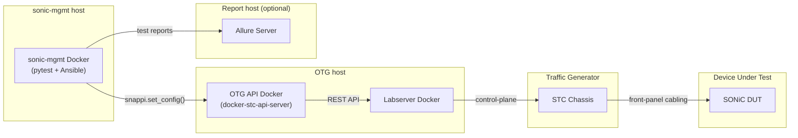

# # run_snappi_test.sh — Deployment and Test Automation Guide

## Overview

The `run_snappi_test.sh` script provides a one-command solution for deploying, configuring, validating, and testing a Snappi/OTG/STC-based SONiC lab environment.

Built on top of the workflow documented in the
[Snappi Environment Setup and Quick Test Guide](../README.md), it automates environment provisioning, testbed configuration generation, minigraph deployment, deployment and test parameters are managed through a single [`config.yaml`](config.yaml) file.

`config.yaml` has exactly two top-level sections, which follow the split of the guide:

| Section | Guide | Answers |
|---|---|---|
| `deployment:` | [§3](../README.md#3-deploy-the-test-environment) | What the tool stands up, from which images, and how it is cleaned up. Read by every run; `--deploy-only` reads nothing else. |
| `testbed:` | [§4](../README.md#4-configure-the-snappi-testbed) | How the lab looks to sonic-mgmt and the tests: devices, links, inventory, testbed, topology, and the addresses and credentials of external equipment. Not needed by `--deploy-only`. |

The solution supports deployment of sonic-mgmt, Labserver, the OTG API Service, the STC chassis, and an optional virtual SONiC DUT (`sonic-vs`).

> **ℹ️ Intended use.** This tool is designed exclusively for fixed pre-test and
> smoke testing of a **1 TGen + 1 DUT** setup. It is not intended to support
> arbitrary sonic-mgmt testbeds, custom topologies, or general-purpose
> sonic-mgmt test execution. It also supports deploying a general snappi test
> environment (sonic-mgmt tester, Labserver, OTG service, sonic-mgmt source,
> patch and custom tests) next to your **own** physical DUT and STC chassis
> (`deployment.target: physical`, `--deploy-only`); for that, the tool deploys
> the environment only: it does not generate, validate or support the testbed
> or the tests you run in it. **Only the testbed this tool generates from
> `config.yaml` is supported.**

> **ℹ️ Supported SONiC images: community SONiC only.** This script (and the
> bundled sonic-mgmt baseline commit + patch) is intended for a quick deploy and
> smoke test of a **1 TGen + 1 DUT** setup running **community (upstream) SONiC**
> — `sonic-vs` or community-image hardware. It is **not validated for Enterprise
> SONiC or other vendor SONiC forks**, whose DUT-side Python APIs and config CLI
> can differ from community SONiC and break stock sonic-mgmt modules. See the
> `deploy-mg` warning in [§7.8](#78-deploy-mg-pretest-smoke-test-librun_testssh).

> **⚠️ Hardware warning — a physical DUT is modified by this tool in two ways.** With
> `deployment.target: physical`:
> 1. **Minigraph push (`deploy-mg`)** pushes a generated minigraph and **replaces the
>    real switch's running configuration**. It runs only for an explicit `--deploy-mg`
>    or with `testbed.deploy_minigraph: true`; the default `auto` never pushes to a
>    physical DUT. Use only a dedicated lab DUT, back up its config first, and never
>    run it against a production or shared switch.
> 2. **SSH key install**: `--access-check` and every test stage ensure the sonic-mgmt
>    public key exists in the DUT admin user's `~/.ssh/authorized_keys`, appending it
>    **only if it is missing** (repeat runs leave the file unchanged). SONiC
>    configuration is not modified.
>
> `--deploy-only` never touches a physical DUT.

It is **idempotent and reuse-aware**: re-running it does not blindly tear
down and rebuild everything. Already-healthy pieces (the sonic-mgmt
container, the sonic-mgmt checkout, the Labserver, the OTG service) are
detected and reused; only the containerlab topology is always destroyed and
redeployed, because that piece is fully tool-owned and cheap to recreate.

---

## Contents

- [1. Architecture](#1-architecture)
- [2. Prerequisites](#2-prerequisites)
- [3. Quick Start](#3-quick-start)
  - [Virtual lab (the validated default)](#virtual-lab-the-validated-default)
  - [Virtual lab, deploy only](#virtual-lab-deploy-only)
  - [Physical DUT and STC chassis](#physical-dut-and-stc-chassis)
- [4. Directory Layout](#4-directory-layout)
- [5. Command-Line Usage](#5-command-line-usage)
- [6. config.yaml Reference](#6-configyaml-reference)
  - [`deployment:` — what the tool stands up](#deployment--what-the-tool-stands-up)
  - [`testbed:` — how the lab looks to sonic-mgmt and the tests](#testbed--how-the-lab-looks-to-sonic-mgmt-and-the-tests)
  - [Reference notes](#reference-notes): [address ownership and Labserver / OTG service pairs](#labserver--otg-service-pairs-and-the-address-ownership-rule), [version validation](#version-validation), [migrating a legacy `config.yaml`](#migrating-a-legacy-configyaml)
- [7. What Each Phase Does](#7-what-each-phase-does)
- [8. Reuse & Idempotency Behavior](#8-reuse--idempotency-behavior)
- [9. Failure Handling & `deployment.cleanup.env_on_failure`](#9-failure-handling--deploymentcleanupenv_on_failure)
- [10. `--destroy` and Ownership Tracking](#10---destroy-and-ownership-tracking)
- [11. Logs and Reports](#11-logs-and-reports)
- [12. Troubleshooting](#12-troubleshooting)
- [13. Command Cheat-Sheet](#13-command-cheat-sheet)

---

## 1. Architecture



| Component | Role |
|---|---|
| **sonic-mgmt Docker** | Runs Ansible playbooks and the `pytest` test suite. Talks to the DUT over SSH and to the traffic generator through the `snappi` SDK. |
| **OTG API Docker** (`docker-stc-api-server`) | Translates `snappi` API calls into STC/Labserver REST calls. |
| **Labserver** | Manages STC chassis port reservation/resource allocation. |
| **STC Chassis** | The traffic generator. With `deployment.target: virtual` (default), deployed as a containerlab node wired to a virtual DUT (`sonic-vs`, also a containerlab node). With `deployment.target: physical`, both the chassis and the DUT are pre-existing real hardware, cabled to each other outside this tool's control - no containerlab node is created for either. |
| **Allure Server** *(optional)* | Collects and renders HTML test reports. |

Everything above can be stood up on a single Linux host, including a single
WSL2 instance on Windows — this script detects WSL and applies the one extra
step it needs (`mount --make-rshared /`) automatically. Steps like this may
prompt for your sudo password — see [§2](#2-prerequisites) ("Sudo Password
Prompts") for details.

The OTG API Docker and Labserver can be deployed together as one Docker Compose
stack (`deployment.otg_labserver.docker_compose.enabled: true`, the default), or
as two independent components that each follow their own mode
(`docker_compose.enabled: false`, then `labserver.mode` / `otg_service.mode` =
`standalone` or `provisioned`, so any mix is possible) — see [§6](#6-configyaml-reference)
and [§7.6](#76-lab-services-deployment-libdeployshphase_deploy_services). Either way, the relationship shown above
(OTG talks to Labserver over REST) is the same.

---

## 2. Prerequisites

**Host:** a Linux machine (or WSL2 instance) with `sudo`/root access and
outbound network reachability to GitHub and your package mirrors.

**Important: Run Docker Without `sudo`**

Membership in the `docker` group is required before running the automation.

While some script-managed Docker CLI operations can be executed with elevated privileges, not all Docker interactions can be intercepted or wrapped by the script. In particular:

- The sonic-vs image build process invokes `docker` commands from within the upstream `vrnetlab` Makefiles. These commands execute in separate shell processes and do not inherit the script's Docker wrapper logic.
- `containerlab` communicates directly with the Docker Engine through the Docker API/socket rather than invoking the Docker CLI, so it cannot be transparently redirected through `sudo docker`.

As a result, users without access to the Docker daemon (typically provided through membership in the `docker` group) may encounter permission errors during image build, deployment, or test execution.

To avoid these issues, add your user account to the `docker` group:

```bash
sudo usermod -aG docker $USER
```

Then log out and log back in, run `newgrp docker`, or restart the WSL
session (`wsl --shutdown`) for the change to take effect. Afterward, Docker
commands can be executed directly without `sudo`.

**Sudo Password Prompts**

On Ubuntu 24.04 (including WSL), certain setup operations require elevated
privileges and may prompt for a sudo password during environment
preparation. This is expected behavior and may occur when the script
performs system-level configuration steps (for example, mount propagation
configuration required by containerlab).

Users should ensure their account has sudo privileges before running the
automation.

If a fully unattended execution is required, advanced users may optionally
configure passwordless sudo (`NOPASSWD`) for the specific commands required
by their environment, subject to their organization's security policies.

**Software:** none of it needs to be pre-installed — phase 1
(`phase_env_check`) installs whatever is missing: `git`, `sshpass`, `curl`,
`jq`, `make`, Docker, Docker Compose, and [containerlab](https://containerlab.dev/),
plus `python3` + `PyYAML`. This runs before anything needs Docker, so a host with
no Docker installed is fine. Pass `--skip-env-check` to skip this phase if your
host is already provisioned; Docker must then already be installed and reachable,
or the run stops with "docker is not installed" / "docker is unreachable".
`--skip-env-check` only matters for `full` and `deploy-only`, the only modes that run
phase 1.

**Licensed VIAVI artifacts** — these are **not** public and are not part of
the `sonic-mgmt` repository. Contact VIAVI support to obtain them, then drop
them into `deployment.images.dir` (default `./images`, next to `config.yaml`):

| Artifact | Filename pattern | Version source |
|---|---|---|
| TestCenter (STC) chassis Docker image (`deployment.target: virtual` only) | `stc_<version>.tgz`, or a zip distribution `Spirent_TestCenter_Docker_<version>.zip` containing that same tgz (auto-extracted on first use) | `deployment.stc.version`, verbatim |
| Labserver Docker image (when this tool deploys the Labserver) | `labserver-<version>.tar.xz` | derived from `deployment.stc.version`, exact match |
| OTG API service installer (when this tool deploys the OTG service) | `otgservice.<major.minor>.*.sh` | derived from `deployment.stc.version`, **major.minor prefix only** |

Run `./run_snappi_test.sh --list-versions` at any time to see which STC
versions are currently deliverable/testable — from what's sitting under
`deployment.images.dir` **and** whatever's already loaded into `docker images` (an
`stc:<version>` or `*labserver*:<version>` tag needs no artifact file at
all), whether the version configured in `deployment.stc.version` is one of them,
and a final rollup line of every version that's fully ready right now — see
[§5](#5-command-line-usage).

The Labserver image and OTG service installer above are required whenever this
tool deploys those components, whether together
(`deployment.otg_labserver.docker_compose.enabled: true`) or separately
(`enabled: false` with `standalone` modes) — the difference between the two is
only *how* they're deployed, not which artifacts are needed (see
[§7.6](#76-lab-services-deployment-libdeployshphase_deploy_services)). A
component described as `provisioned` already exists elsewhere, is never
deployed by this tool, and needs no artifact. With `deployment.target:
physical`, no STC image is needed either: the chassis is real hardware.

**`docker_compose.enabled: true` only** — this mode uses the
[`testcenter-otg-setup`](https://github.com/Viavi-TestCenter/testcenter-otg-setup)
checkout this container solution itself ships inside (one directory above
`container/`) directly — no separate clone, and no manual prerequisite or
network access needed for it.

`deployment.stc.version` is the only version you set — Labserver and the OTG
service are not configured separately. Labserver expects an exact
match (`deployment.stc.version: "5.62.0766"` → `labserver-5.62.0766.tar.xz`),
since VIAVI ships it lockstep with STC. The OTG service installer is
versioned independently (its own patch/build numbering, e.g.
`otgservice.5.62.0009-20260112080331.sh`), but is still qualified per STC
release, so only the leading `major.minor` (`"5.62"` out of `"5.62.0766"`)
is required to match — glob-searched as `otgservice.5.62.*.sh`, erroring if
that matches zero or more than one file under `deployment.images.dir`. Confirm the
exact artifacts with VIAVI support for your lab; a mismatched combination is
a common source of control-plane connection failures. Each of these is
checked in the same order before the artifact file is ever required:
already running (or, for the Labserver, already loaded into `docker
images`) → nothing to do; only if neither is true does the script fall back
to the artifact file (see [§7.2](#72-artifact-validation-libenv_checkshphase_check_artifacts)).

When `deployment.target: virtual`, the STC chassis container is always rebuilt
on the configured `deployment.stc.version` (see §8), so it can never silently
drift. (When `deployment.target: physical`, there is no chassis container at all -
`deployment.stc.version` then only selects the Labserver image and OTG installer
this tool deploys, and it must equal the software version installed on your
chassis. The tool never checks that: see [Version validation](#version-validation)
in §6 and [§12](#12-troubleshooting).) The Labserver
is not rebuilt: it's reused as-is whenever a running/responding container is already
there, without checking whether it matches the version derived from
`deployment.stc.version`. If it doesn't match, the script logs a warning naming
the running image and the configured version, then continues with the
mismatched Labserver rather than recreating it — recreating in place risks
dropping live sessions/state on it. To force the Labserver onto the
configured version, remove it yourself first (`docker rm -f labserver`, or
`--destroy` if it's tool-owned) before re-running — or bump
`deployment.stc.version` itself, which [§7.0](#70-version-change-check-libdeployshphase_check_version_change)'s
version-change check will do for you automatically by default.

**License server (`deployment.stc.license_server`):** the STC license server for a
virtual (containerized) STC chassis, and the one written into a Labserver this tool
deploys (`SPIRENTD_LICENSE_FILE`) — a network license server or a local Spirent license
manager for a hardware dongle, format `@hostname` or `host:port`. Contact
[VIAVI support](https://www.viavisolutions.com/support) if you don't have one. A
physical chassis and a provisioned (already existing) Labserver have their own
licensing path, so the field is not used there.

The value is never required and never stops a run: your license may come from
somewhere this tool cannot see (an Aion license, or a license server you configured
in the Labserver yourself). When it is empty or still the placeholder
`@license-server.example.com`, the tool only warns:

- `--deploy-only` (virtual lab): deploys the Labserver without license configuration
  and prints a warning at the end of the run.
- The full run, `--test-only` and `--smoke-test` (virtual lab): print a warning
  before the test cases start, and carry on. If the Labserver was deployed without a
  license server and the value is set now, they warn that `--deploy-only` must be run
  again to redeploy it with the license.
- `--pretest`, `--access-check`, `--gen-config`, `--deploy-mg`, `--validate`,
  `--destroy`, `--show-config` and `--list-versions` never check it (see the
  Mode → stages matrix in [§5](#5-command-line-usage)).

If you license the lab another way on purpose, set
`deployment.stc.license_managed_externally: true` (optional, default `false`) to
acknowledge it: all of the warnings above are then silenced. It changes nothing
else — a Labserver this tool deploys still gets no license written into it unless
`license_server` holds a valid value.

**Virtual DUT:** if `deployment.target: virtual`, either have the
`sonic-vs` image already tagged in `docker images`, or place a
`sonic-vs-*.tar.gz`/`.gz` archive under `deployment.images.dir` (or set
`deployment.dut_vs.image_archive` explicitly). An image already in `docker images` is
always used as-is - even a custom/manually-built tag with no corresponding
SONiC branch name. If none of those apply and `deployment.dut_vs.image`'s repository is
`vrnetlab/sonic_sonic-vs` (any tag - `master` or a release branch like
`202511`), the script downloads and builds it for you automatically (guide
§3.3) unless `deployment.dut_vs.build_sonic_vs` is set to `false` - see §6 below.
`deployment.dut_vs.download_source` (default `auto`) controls where the download comes
from: Azure Pipelines, sonic.software, or Azure with a sonic.software
fallback. Skip this entirely for `deployment.target: physical`.

**sonic-mgmt source:** leave `deployment.sonic_mgmt.source_dir` empty to let the script
clone and manage its own checkout, or point it at an existing checkout (e.g.
one you already use for other test work) to reuse as-is — see
[§7.3](#73-sonic-mgmt-source-libsonic_mgmtshphase_sonic_mgmt_source) for exactly how each mode behaves.

---

## 3. Quick Start

> **⚠️ Hardware warning — physical DUT.** With `deployment.target: physical`, a
> minigraph push (`deploy-mg`) **replaces the real switch's running
> configuration** — not safe on a production or shared DUT. It runs only for an
> explicit `--deploy-mg` or with `testbed.deploy_minigraph: true`; the default `auto`
> never pushes to a physical DUT. `--access-check` and every test stage also append
> the sonic-mgmt public key to the DUT's `authorized_keys` if it is missing. Before
> hardware testing: (1) use a dedicated lab DUT, (2) back up its config (e.g.
> `config_db.json`) and know how to restore it, (3) make sure `testbed.dut.hwsku`,
> `testbed.dut.iface_speed`, `testbed.dut.total_ports`, `testbed.dut.links[]` and
> `testbed.topology.*` match the real platform, and (4) confirm the DUT runs
> community SONiC. Details: [§7.8](#78-deploy-mg-pretest-smoke-test-librun_testssh).

### Virtual lab (the validated default)

```bash
cd container

# 1. Place VIAVI artifacts (see §2) under ./images/, or point
#    deployment.images.dir at wherever you keep them.

# 2. Edit config.yaml for your lab. The shipped file is the virtual lab
#    (deployment.target: virtual, everything deployed on this host), so the
#    minimum is:
#      deployment.stc.version         the STC version your artifacts are for (§2/§6)
#      deployment.stc.license_server  your STC license server (§2/§6); a missing one only warns
#    For a physical DUT and STC chassis, see "Physical DUT and STC chassis" below.
#
#    Optional - Allure report page: deployment.allure.enabled is false by
#    default, so nothing Allure-related is deployed and no report page is
#    produced. Set deployment.allure.enabled: true to deploy the report
#    server and publish the test results to it.

# 3. Check the whole file (deployment: and testbed:) and exit - nothing is
#    deployed or contacted:
./run_snappi_test.sh --validate

# 4. Check which TestCenter (STC) versions are currently deliverable/testable,
#    based on the artifacts already sitting under deployment.images.dir, and
#    confirm deployment.stc.version (§6) is one of them:
./run_snappi_test.sh --list-versions

# 5. Run it.
./run_snappi_test.sh

# Or, against a config file living elsewhere:
./run_snappi_test.sh -c /path/to/my-lab-config.yaml

# Preview the resolved configuration without deploying or testing anything.
# It prints, for the STC chassis, Labserver, OTG service and DUT, the resolved
# address and which section (deployment: or testbed:) owns it:
./run_snappi_test.sh --show-config
```

Every run opens with a `SNAPPI TEST CONFIGURATION` block (versions,
deployment topology with each component's address and owning section,
sonic-mgmt source, cleanup policy) and, for a full run,
ends with a `SNAPPI TEST SUMMARY` block and `RESULT: PASS` (or `FAIL`) — see
[§11](#11-logs-and-reports) for what else is written to disk.

- **Typos are reported, not silently ignored.** A key the tool does not know under a
  known section (for example `docker_compose: {enable: false}`) is logged as
  `unknown key ... - ignored (did you mean 'enabled'?)` and falls back to its default, so
  read the warnings of a first run; `--validate` shows them too.
- **A loopback address of an existing Labserver or OTG service is resolved.** Written as
  `127.0.0.1` / `localhost` in `testbed.endpoints` (or as `host_ip`), it is replaced by this
  host's address, because the sonic-mgmt container and `otgctl` cannot reach this host
  through loopback.
- **`deployment.allure.enabled` is `false` by default** (the previous shipped file had it `true`).
  The default virtual lab neither deploys the report server nor publishes results to it
  (the Allure arguments are passed to `pytest` only when it is enabled). Set
  `deployment.allure.enabled: true` (and keep `testbed.reporting.allure_project_id`) to
  get the report page; its URL is then printed in the run summary.
- **`--validate`** checks the whole file, both sections, exactly as every test stage
  would, and does nothing else. Each stage validates only the keys it reads
  (`--deploy-only`: `deployment:`; `--access-check`: also `testbed.endpoints.*` and,
  for a physical DUT, `testbed.dut.mgmt_ip` / `.credentials`; every later stage: all of
  `testbed:`), so a file can pass `--deploy-only` or `--access-check` and still fail
  `--gen-config`; `--validate` finds that up front. It does not run the
  license-server warning (§2).
- **`--show-config`** loads the file and prints the resolved run configuration, then
  exits (read-only: no lock, no log directory, no phase runs). A mis-placed address —
  the usual mistake when switching a lab between virtual and physical — shows up
  as the wrong `owner:`. Problems in `testbed:` are printed as warnings there instead
  of errors.
- **A legacy flat `config.yaml` still loads.** A file in the previous layout (top-level
  `images:`, `testcenter:`, `dut:`, `otg:`, `sonic_mgmt:`, `cleanup:`, `logging:`,
  `allure:` or `topology:`, or `deployment.mode` / `deployment.labserver` / ...) is
  migrated in memory to the `deployment:` / `testbed:` layout and a deprecation warning
  is logged on every run; the file on disk is not changed. `--show-config` prints the
  resolved configuration (each address with the section that owns it) and, for a legacy
  file, the migrated `deployment:` / `testbed:` YAML to copy into `config.yaml` (passwords
  are masked as `********`: copy the real values from your old file; the key map in
  [§6](#migrating-a-legacy-configyaml) explains each move).
  One behaviour differs after migration: `testbed.deploy_minigraph` is `auto`, so a legacy
  *physical* lab no longer gets a minigraph pushed automatically (set
  `testbed.deploy_minigraph: true` to keep the old behaviour; it overwrites the DUT's
  running configuration), and the loader says so in its warning. A file that mixes
  legacy top-level keys with the new `deployment.target` is rejected, naming the
  offending keys.

### Virtual lab, deploy only

The `testbed:` section can be absent. The chassis, Labserver, OTG service and virtual
DUT are all defined in `deployment:` (`target: virtual`, `docker_compose.enabled: true`,
`stc.mgmt_ip`, `dut_vs.*`), and `--deploy-only` reads nothing else. A complete file:

```yaml
deployment:
  target: virtual
  images:
    dir: "./images"
  otg_labserver:
    docker_compose: { enabled: true, keep_build_image: true }
  stc:
    version: "5.62.0766"
    license_server: "@license-server.company.com"      # replace with your license server
    mgmt_ip: "192.168.1.2"
  dut_vs:
    image: "vrnetlab/sonic_sonic-vs:master"
    hostname: "sonic-s6100-dut1"
    mgmt_ip: "192.168.1.3"
    hwsku: "Force10-S6000"
    credentials: { user: admin, password: admin }
  sonic_mgmt:
    source_dir: ""
    repo: "https://github.com/sonic-net/sonic-mgmt.git"
    branch: "master"
    baseline_commit: "91d8be388"
    patch: { apply: true, file: "./snappi-stc-patch-v0.1.patch" }
    custom_tests: { overwrite: true, source_dir: "../example/sonic_snappi/tests" }
  allure:
    enabled: false
  cleanup:
    env_on_failure: false
    replace_on_version_change: true
  logging:
    dir: ""
```

```bash
./run_snappi_test.sh --deploy-only
```

Without a `testbed:` section the number of veth links between the virtual chassis and
the virtual DUT is 2 (`deployment.dut_vs.link_count`; when the `testbed:` section is
present it is `len(testbed.dut.links)`). Every later stage (`--gen-config`,
`--deploy-mg`, `--pretest`, `--smoke-test`, `--test-only` and the full run) reads the
whole `testbed:` section, so add it (the shipped `config.yaml` has it) before running
them; with `target: virtual` the DUT's name, address, hwsku and credentials are
inherited from `deployment.dut_vs` and are omitted from `testbed.dut`.

### Physical DUT and STC chassis

The examples below cover one scenario: a user with a **physical DUT and a physical STC
chassis** who wants this tool only to deploy the sonic-mgmt tester container, the
Labserver, the OTG service, and the sonic-mgmt test source with the patch and the
customized test cases. They run `--deploy-only` with the `deployment:` section of the
example, then `--access-check` to confirm the connection to the DUT and the chassis.
`--access-check` needs a small `testbed:` section with the chassis IP, the DUT IP and
the DUT login, and nothing else from `testbed:`. `--deploy-only` itself never touches
the DUT or the chassis and does not read `testbed:` (the one exception is example 2).

```
./run_snappi_test.sh --deploy-only     # tester container, Labserver, OTG service, sonic-mgmt source, patch, custom tests
# add the testbed: section (chassis IP, DUT IP, DUT login), then:
./run_snappi_test.sh --access-check    # connection status: chassis and DUT reachable; sonic-mgmt key on the DUT
```

The three examples differ only in what already exists for the Labserver and OTG service.
In all three, `target: physical`, so `deployment.dut_vs.*` and `deployment.stc.mgmt_ip`
are not needed, and the chassis and DUT addresses are in `testbed:`.
`deployment.stc.version` is needed in examples 1 and 2 (an OTG service or Labserver is
deployed, and the installer or image is chosen by version) and not in example 3.
`deployment.stc.license_server` is used only by a tool-deployed Labserver, so only in
example 1. Example 1 is complete, nothing abbreviated. Examples 2 and 3 show only what
differs and say "as in example 1" in a comment for the rest of `deployment:` (`images`,
`sonic_mgmt`, `allure`, `cleanup`, `logging`). `deploy_minigraph` is not set in any of
them: the default `auto` means "never push" for `target: physical`, so none of the
examples overwrites the DUT's configuration.

**Example 1: neither Labserver nor OTG service exists (the main case).** The tool deploys
both on this host, together, plus the sonic-mgmt tester container and source. The
`testbed:` section can be added after `--deploy-only`; it is shown here for completeness.

```yaml
deployment:
  target: physical
  images:
    dir: "./images"
  stc:
    version: "5.62.0766"                               # selects the Labserver image and OTG installer; must equal the chassis version (the tool does not check it)
    license_server: "@license-server.example.com"      # written into the deployed Labserver's SPIRENTD_LICENSE_FILE
  otg_labserver:
    # host_ip: ""                                      # optional, auto-detected when empty; used for both components
    docker_compose: { enabled: true, keep_build_image: true }
  sonic_mgmt:
    source_dir: ""
    repo: "https://github.com/sonic-net/sonic-mgmt.git"
    branch: "master"
    baseline_commit: "91d8be388"
    patch: { apply: true, file: "./snappi-stc-patch-v0.1.patch" }
    custom_tests: { overwrite: true, source_dir: "../example/sonic_snappi/tests" }
    keep_sonic_mgmt_src: true
  allure:
    enabled: false                                     # set true to also deploy the Allure report server
  cleanup:
    env_on_failure: false
    replace_on_version_change: true
  logging:
    dir: ""

testbed:                                               # not read by --deploy-only; needed from --access-check on
  endpoints:
    stc_chassis_ip: "10.0.0.20"                        # the real STC chassis
    # no labserver_ip / otg_service: both are deployed, their address is deployment.otg_labserver.host_ip
  dut:
    mgmt_ip: "10.0.0.30"                               # the real DUT's management IP
    credentials: { user: admin, password: admin }      # used to log in and install the sonic-mgmt key
```

Use `docker_compose.enabled: false` with both modes `standalone` instead if you want the
two as separate containers. The Labserver on this host must be able to reach the
physical chassis at `stc_chassis_ip`. Replace the placeholder values (the license server,
which is only warned about while it is still `@license-server.example.com`, and the
`10.0.0.x` addresses) with your own.

**What `--access-check` needs and does.** It needs the chassis address, the DUT address
and the DUT login, in a `testbed:` section, and nothing else from `testbed:` (the minimal
section in example 1). It checks that the chassis and the DUT are reachable and that the
sonic-mgmt container can log in to the DUT. For a physical DUT it also appends the
sonic-mgmt public key to the DUT admin user's `~/.ssh/authorized_keys` if it is missing.
That is its only write: SONiC configuration is not modified and no minigraph is pushed.
If the Labserver or OTG service is provisioned (examples 2 and 3), their
`testbed.endpoints` entries are needed as well. It does not check cabling, ports or the
STC version.

**Example 2: Labserver exists, no OTG service.** The tool deploys a standalone OTG service
on this host and points it at the existing Labserver.

```yaml
deployment:
  target: physical
  stc: { version: "5.62.0766" }                        # selects the OTG installer; must equal the version on the chassis and Labserver
  otg_labserver:
    # host_ip: ""                                      # optional, auto-detected when empty; the OTG service is reached here
    docker_compose: { enabled: false }
    labserver:   { mode: provisioned }                 # address is in testbed.endpoints
    otg_service: { mode: standalone }                  # deployed here, port fixed at 50051
  # images, sonic_mgmt, allure, cleanup, logging: as in example 1
  # no stc.license_server: the Labserver is not deployed here, it has its own licensing

testbed:                                               # here --deploy-only already reads labserver_ip
  endpoints:
    stc_chassis_ip: "10.0.0.20"
    labserver_ip:   "10.0.0.21"                        # the OTG service is started against this
    # no otg_service: it is deployed, its address is deployment.otg_labserver.host_ip
  dut:
    mgmt_ip: "10.0.0.30"
    credentials: { user: admin, password: admin }
```

This is the one case where `--deploy-only` reads a `testbed:` key (`labserver_ip`),
because the OTG service needs the Labserver's address to start
([§6, Labserver / OTG service pairs](#labserver--otg-service-pairs-and-the-address-ownership-rule)),
so the `testbed:` section has to exist before `--deploy-only`. The provisioned Labserver
must be reachable from this host.

**Example 3: Labserver and OTG service both already exist.** Only the sonic-mgmt tester
container and source (patch, custom tests) are deployed. No Labserver, OTG service,
chassis or DUT is deployed, so `deployment:` holds no component addresses.

```yaml
deployment:
  target: physical
  otg_labserver:
    docker_compose: { enabled: false }
    labserver:   { mode: provisioned }
    otg_service: { mode: provisioned }
  # images, sonic_mgmt, allure, cleanup, logging: as in example 1
  # no stc: nothing is deployed that is chosen by version; the tool never checks the versions

testbed:
  endpoints:
    stc_chassis_ip: "10.0.0.20"
    labserver_ip:   "10.0.0.21"
    otg_service: { ip: "10.0.0.22", port: 50051 }
  dut:
    mgmt_ip: "10.0.0.30"
    credentials: { user: admin, password: admin }
```

**Going on to the pretest and smoke test (optional).** The pretest and smoke test are what
this tool is designed for (see *Intended use* at the top); on a physical DUT they are
supported but not validated. To run them, extend the minimal `testbed:` section to the
full one below. The `endpoints` and the DUT address and login stay as they are. Then run
`--gen-config` and `--pretest` or `--smoke-test`; each test stage runs `--access-check`
and `--gen-config` itself first. A `testbed:` section with only the minimal keys passes
`--access-check` and then fails `--gen-config`, naming the missing keys. The full section
for example 1:

```yaml
testbed:
  endpoints:
    stc_chassis_ip: "10.0.0.20"
  dut:
    hostname: "dut1"
    mgmt_ip: "10.0.0.30"
    hwsku: "Force10-S6000"
    credentials: { user: admin, password: admin }
    iface_speed: "40000"
    total_ports: 32
    links:
      - { dut_port: Ethernet0, stc_port: Card1/Port1, bandwidth: 40000, vlan_id: 1000 }
      - { dut_port: Ethernet4, stc_port: Card1/Port2, bandwidth: 40000, vlan_id: 1000 }
  otg: { credentials: { user: admin, password: admin }, ssh_user: "" }
  definition:
    conf_name: "vms-snappi-sonic"
    inv_name: "snappi-sonic"
    dut_group_name: "sonic_dell64_40"
    server_group: "Server_6"
  topology:
    name: "tgen_ptf32"
    dut_type: "ToRRouter"
    vlan:
      id: 1000
      prefix: "192.168.100.1/24"
      prefix_v6: "fc02:1000::1/64"
      tag: 1000
      mac: "00:aa:bb:cc:dd:ee"
  reporting:
    allure_project_id: "snappi-smoke"
```

```
./run_snappi_test.sh --gen-config      # testbed files for sonic-mgmt
./run_snappi_test.sh --smoke-test      # or --pretest
```

> **Note — what the physical-DUT examples leave alone, and what they write.**
> - With `target: physical` the default `deploy_minigraph: auto` never pushes a
>   minigraph, so `--test-only`, `--pretest` and `--smoke-test` leave the physical DUT's
>   configuration alone (you must have configured it for the testbed yourself). The
>   configuration is overwritten only by an explicit `--deploy-mg` or by setting
>   `deploy_minigraph: true`, and only on a dedicated lab DUT.
> - Every run that reaches the access step (`--access-check` and each test stage)
>   ensures the sonic-mgmt public key exists in the DUT's `authorized_keys` (appended
>   only if missing, so repeat runs leave the file unchanged); `--deploy-only` never
>   touches the DUT.
> - Only the testbed this tool generates is supported (see *Intended use* at the top of
>   this guide). The generated files are overwritten on every test run: do not hand-edit
>   them.

---

## 4. Directory Layout

```
container
├── run_snappi_test.sh              # entry point
├── config.yaml                     # single source of truth for a lab run
├── snappi-stc-patch-v0.1.patch     # STC/OTG compatibility patch for sonic-mgmt
├── lib/                            # one file per phase, sourced by run_snappi_test.sh
│   ├── common.sh                   # logging, locking, ownership-state helpers
│   ├── config.sh                   # config.yaml loader/validator (wraps config_loader.py)
│   ├── config_loader.py            # config.yaml schema validation, address ownership, legacy-layout migration -> CFG_* shell vars
│   ├── env_check.sh                # phase 1-2: host deps + artifact validation
│   ├── sonic_mgmt.sh                # phase 3: sonic-mgmt checkout + container
│   ├── gen_config.sh               # stage 3: Ansible/testbed/topology generation + inventory check (+ the containerlab topology, called by the deploy phase)
│   ├── patch_testbed_yaml.py        # inserts/replaces this testbed's entry in testbed.yaml
│   ├── deploy.sh                   # phase 5: labserver/OTG/containerlab + DUT key install + --destroy
│   ├── verify.sh                   # stage 2: access check (reachability, DUT login, key install on a physical DUT)
│   ├── run_tests.sh                # phase 7: deploy-mg, pretest, smoke test
│   ├── cleanup.sh                  # phase 8: cache cleanup / failure teardown
│   ├── report.sh                   # phase 9: summary + summary.json
│   └── versions.sh                 # --list-versions: scans deployment.images.dir + docker images
├── images/                         # your local cache of VIAVI + sonic-vs artifacts
│   └── vrnetlab/                   # cached vrnetlab checkout used to build sonic-vs (see §2/§7.2)
├── logs/<timestamp>/               # per-run logs (see §11)
└── .run_snappi_test/               # tool-owned work dir (see below)
    ├── state.env                   # OWN_* flags (what --destroy is allowed to remove)
    │                               #   + DEPLOY_MG_DONE (see §5)
    ├── run.lock                    # prevents two concurrent runs on the same config
    ├── snappi-topology.yml         # generated containerlab topology (written by the deploy stage, deployment.target: virtual only)
    ├── containerlab-deploy.log     # raw `containerlab deploy` output (deployment.target: virtual)
    ├── otgservice/                 # extracted OTG service installer (standalone OTG service)
    ├── testcenter-otg-setup/        # docker_compose.enabled: true only: otg-compose.yaml/
    │                               #   Dockerfile/entrypoint.sh copied from the
    │                               #   testcenter-otg-setup checkout one directory
    │                               #   above container/, plus the generated .env
    │                               #   and image-pin override (see §7.6)
    ├── docker-compose-up.log       # raw `docker compose up` output (deployment.otg_labserver.docker_compose.enabled: true)
    ├── allure/                     # only when deployment.allure.enabled: true
    │   ├── docker-compose.yml      # generated allure + allure-ui stack definition
    │   └── projects/               # Allure results/history volume, mounted into the container
    └── sonic-mgmt/                 # default sonic-mgmt clone (if deployment.sonic_mgmt.source_dir is empty)
```

`.run_snappi_test/` is entirely disposable — it's regenerated on the next
run — *except* that if you let the tool own the sonic-mgmt clone (empty
`deployment.sonic_mgmt.source_dir`), deleting it also deletes that checkout. Prefer
`--destroy` over `rm -rf` so teardown stays scoped to tool-owned resources.
Set `deployment.sonic_mgmt.keep_sonic_mgmt_src: true` if you want `--destroy` itself to
leave that clone in place too.

---

## 5. Command-Line Usage

```
./run_snappi_test.sh [-c config.yaml] [options]
```

The run is split into **stages** (table below). Deployment is separate from the testbed
configuration and from the minigraph push, so that a deploy-only user needs nothing from
`testbed:` and a physical DUT is never overwritten unless you ask.

> **⚠️ Hardware warning:** with `deployment.target: physical`, only an explicit
> `--deploy-mg`, or an automatic push under `testbed.deploy_minigraph: true` (full run,
> `--test-only`, and `--pretest`/`--smoke-test` if it hasn't already run), runs `deploy-mg`,
> which **overwrites the real DUT's running configuration**. The default `auto` never pushes
> to a physical DUT. `--access-check` and every test stage additionally append the
> sonic-mgmt public key to the DUT's `authorized_keys` if it is missing (its only other
> write); `--deploy-only` never touches a physical DUT. See [§7.8](#78-deploy-mg-pretest-smoke-test-librun_testssh).

| Option | Effect |
|---|---|
| `-c, --config <path>` | Path to `config.yaml` (default: `./config.yaml` next to the script). |
| `--skip-env-check` | Skip host dependency check/install (phase 1). |
| `--deploy-only` | **Stage 1.** Deploy the environment (sonic-mgmt source and container, whatever this tool owns of the Labserver/OTG service and the virtual chassis/DUT), then stop. Reads only the `deployment:` section (plus `testbed.endpoints.labserver_ip` when a standalone OTG service runs against a provisioned Labserver). Writes no ansible/testbed files, checks the reachability of no external component, and never touches a physical DUT. |
| `--access-check` | **Stage 2.** Check that every external component (physical chassis and DUT, provisioned Labserver and OTG service) is reachable and that the sonic-mgmt container can log in to the DUT. For a **physical** DUT it also appends the sonic-mgmt public key to the DUT admin user's `~/.ssh/authorized_keys` if it is missing (its only write; SONiC configuration is not modified, no minigraph is pushed). Needs only `testbed.endpoints.*` and `testbed.dut.{mgmt_ip, credentials}`; needs the sonic-mgmt container running (run `--deploy-only` first). |
| `--gen-config` | **Stage 3.** Regenerate the testbed config files (device/link CSVs, Ansible inventory, `testbed.yaml`, topology vars, DUT/OTG credentials — guide §4.1–4.7 — plus the Ansible password file), then check that the inventory lists the DUT. Requires the sonic-mgmt source checkout (does not deploy or clone anything), contacts no external component, and runs no tests. The inventory check is skipped with a warning if the sonic-mgmt container is not running. |
| `--deploy-mg` | **Stage 4.** Run stages 2–3, then push the generated minigraph. Always pushes, whatever `testbed.deploy_minigraph` says. On a physical DUT this **replaces its running configuration**. Stops after the push — no pretest/smoke test/cleanup. |
| `--pretest` | Run only the pretest against an already-deployed environment (stages 2–3 first). The minigraph is pushed first only when `testbed.deploy_minigraph` resolves to true **and** no push is recorded as done since the environment was last (re)deployed. |
| `--smoke-test` | Run only the Snappi smoke test against an already-deployed environment. Same automatic push rule as `--pretest`. |
| `--test-only` | Do not touch deployed infrastructure (no service deploy, no containerlab destroy/deploy). Stages 2–3, then the minigraph push (only when `testbed.deploy_minigraph` resolves to true), pretest and smoke test against what is already running. |
| `--validate` | Validate the whole `config.yaml` (`deployment:` and `testbed:`) and exit. Nothing is deployed or contacted. |
| `--no-cleanup` | Skip the post-test pytest/Ansible cache cleanup only. Never affects deployed services (see `--destroy` for that). |
| `--destroy` | Remove only resources this tool itself created (see the per-run state file). Never touches externally provisioned services, a user-supplied sonic-mgmt checkout, or a physical DUT. Runs no tests. |
| `--show-config` | Load, validate and print the resolved run configuration (versions, deployment topology including each component's address and which section owns it, sonic-mgmt source, cleanup policy), then exit. Read-only — no lock, no log dir, no phases run. `testbed:` problems are shown as warnings. |
| `--list-versions` | Scan `deployment.images.dir` **and** `docker images` and report which TestCenter (STC) versions are currently deliverable/testable (STC + Labserver present as either an artifact file or an already-loaded `stc:<version>`/`*labserver*:<version>` docker image tag, OTG service installer matching major.minor — see [§2](#2-prerequisites)), plus whether the configured `deployment.stc.version` is ready, and a final rollup line of every version that's fully ready right now. Read-only — no lock, no log dir, no phases run, nothing extracted/downloaded. |
| `-h, --help` | Show usage and exit. |

No flag runs stages 1, 2, 3, then the minigraph push (when `testbed.deploy_minigraph`
resolves to true: `auto` = virtual yes, physical never), then the pretest and the smoke test.

**Stages:**

| Stage | Command | Does | Reads |
|---|---|---|---|
| 1. Deploy | `--deploy-only` | Version-change check, environment prep, artifact validation, sonic-mgmt source (clone, patch, custom tests), sonic-mgmt container, deploy of whatever is tool-owned (Labserver/OTG service, virtual chassis and DUT — the containerlab topology is generated here), and for a **virtual** DUT the SSH key install (its credentials are in `deployment.dut_vs`), plus Allure when enabled. Writes **no** ansible/testbed files and does not contact any external component. | `deployment:` only (exception: a standalone OTG service against a provisioned Labserver also reads `testbed.endpoints.labserver_ip`) |
| 2. Access check | `--access-check` | Reachability of every external component (physical chassis, physical DUT, provisioned Labserver and OTG service), DUT SSH login, and for a **physical** DUT the SSH key install (ensures the key exists in `authorized_keys`, appended only if missing; the one write to a physical DUT). Runs inside the sonic-mgmt container, so stage 1 must have run. Needs none of the generated files, writes no sonic-mgmt files and pushes no minigraph. On a virtual target the same checks run and nothing is written. | `deployment:` for deployed addresses; `testbed.endpoints.*` and, for a physical DUT, `testbed.dut.mgmt_ip` and `.credentials` |
| 3. Gen testbed config | `--gen-config` | Devices CSV, links CSV, inventory, `testbed.yaml`, topology, secrets (guide §4.1–4.7) and the Ansible password file, then the inventory check (`ansible-inventory` lists the DUT host). Contacts no external component. Every test stage runs it, because sonic-mgmt reads these files for every test run. | `deployment:` for deployed addresses, full `testbed:` |
| 4. Deploy minigraph | `--deploy-mg` | Stages 2–3, then push the minigraph (always, whatever `deploy_minigraph` says). | same |
| 5. Pretest / smoke test | `--pretest`, `--smoke-test` | Stages 2–3, plus stage 4 if not already recorded as done and effective `deploy_minigraph` is true, then the pretest (`--pretest`) or the smoke test (`--smoke-test`). | same |
| 6. Test run | `--test-only` | Stages 2–3, then stage 4 **only if effective `deploy_minigraph` is true** (on a virtual lab under `auto`: always pushed), then the pretest and the smoke test. | same |
| 7. Full run | no flag | Stages 1, 2, 3, then 4 if effective `deploy_minigraph` is true, then the pretest and the smoke test. On a virtual lab this pushes the minigraph every run; on a physical DUT the push is skipped under `auto`. | all |

Stages 4–7 each run stage 2 and then stage 3 before their own work, so an unreachable
chassis or DUT fails the run before any file is regenerated. (`--gen-config` on its own does
not run stage 2.) A failed access step or testbed-config generation stops the run before
any push or test; it does not trigger the `deployment.cleanup.env_on_failure` teardown.

**Effective `deploy_minigraph`:** `testbed.deploy_minigraph: auto` (the default) resolves to
true for `deployment.target: virtual` and false for `physical`. A deploy stage clears the
recorded `DEPLOY_MG_DONE` flag (see below), so a virtual lab always gets its minigraph before
tests, exactly as before. A physical DUT is only ever overwritten by an explicit
`--deploy-mg` or an explicit `testbed.deploy_minigraph: true` (the loader then logs a warning
naming the DUT).

**Which part of `config.yaml` each mode validates:** `--deploy-only`, `--destroy` and
`--list-versions` validate `deployment:` only; `--access-check` also validates
`testbed.endpoints.*` and, for a physical DUT, `testbed.dut.mgmt_ip` and `.credentials`;
every other mode (every test stage, `--gen-config`, `--validate`) validates all of
`testbed:` plus the resolved addresses; `--show-config` validates like a test stage but
reports `testbed:` problems as warnings. The trade-off is that a file can pass
`--deploy-only` or `--access-check` and then fail at `--gen-config`; `--validate` checks the
full file and does nothing else.

**Mode → stages matrix** (column headings are the options without the leading `--`;
`full` is the run with no flag):

| Phase (stage) | full | deploy-only | access-check | gen-config | deploy-mg | test-only | pretest | smoke-test | validate | destroy | show-config | list-versions |
|---|:---:|:---:|:---:|:---:|:---:|:---:|:---:|:---:|:---:|:---:|:---:|:---:|
| `config.yaml` validated | all | `deployment:` | + endpoints / DUT login | all | all | all | all | all | all | `deployment:` | all (`testbed:` as warnings) | `deployment:` |
| Env check / artifact validation (1) | ✅ | ✅ | – | – | – | – | – | – | – | – | – | – |
| sonic-mgmt source + container (1) | ✅ | ✅ | – (must already exist)¹ | – (source must already exist)¹ | – (must already exist)¹ | – (must already exist)¹ | – (must already exist)¹ | – (must already exist)¹ | – | – | – | – |
| Labserver / OTG / containerlab / virtual-DUT key / Allure deploy (1) | ✅ | ✅ | – | – | – | – | – | – | – | – | – | – |
| Access check (2) | ✅ | – | ✅ | – | ✅ | ✅ | ✅ | ✅ | – | – | – | – |
| Testbed config generation + inventory check (3) | ✅ | – | – | ✅ | ✅ | ✅ | ✅ | ✅ | – | – | – | – |
| deploy-mg (4) | if effective² | – | – | – | ✅ always | if effective² | if effective² and not already done | if effective² and not already done | – | – | – | – |
| Pretest | ✅ | – | – | – | – | ✅ | ✅ | – | – | – | – | – |
| Snappi smoke test | ✅ (if pretest passed) | – | – | – | – | ✅ (if pretest passed) | – | ✅ | – | – | – | – |
| Cache cleanup³ | ✅ | – | – | – | – | ✅ | ✅ | ✅ | – | – | – | – |
| Teardown tool-owned resources | – | – | – | – | – | – | – | – | – | ✅ | – | – |

¹ `--access-check`, `--deploy-mg`, `--test-only`, `--pretest` and `--smoke-test` all require the
environment to already be deployed — each fails fast with a clear error if the sonic-mgmt
container isn't running or the source checkout isn't present, rather than silently deploying
anything. `--gen-config` only requires the sonic-mgmt **source checkout** (it doesn't need the
container running; the inventory check at its end is skipped with a warning when the container
is down).

² "Effective" means `testbed.deploy_minigraph` resolves to true: `auto` is true for `virtual` and
false for `physical`; an explicit `true`/`false` is taken as written. `--deploy-mg` pushes
regardless.

³ Skipped with `--no-cleanup`, or when the environment was just torn down after a failure
(`deployment.cleanup.env_on_failure`).

`--pretest` and `--smoke-test` skip `deploy-mg` when a prior `deploy-mg` is already
recorded as done for the currently deployed environment — tracked as `DEPLOY_MG_DONE` in
`.run_snappi_test/state.env` — and also when `testbed.deploy_minigraph` resolves to false. That flag is cleared whenever the
deploy stage runs (a `full`/`--deploy-only` run; on a virtual lab it always recreates the
containerlab DUT node) or the environment is torn down (`--destroy`), and set whenever
`deploy-mg` next succeeds — via `full`, `--test-only`, `--deploy-mg`, or automatically via
`--pretest`/`--smoke-test`. Use `--deploy-mg` explicitly to force a rerun without also
running pretest/smoke test.

---

## 6. config.yaml Reference

All relative paths in `config.yaml` resolve against the directory containing
the config file itself, not the current working directory. Passwords in the
shipped file are lab defaults (`admin`/`admin`, matching the containerlab SONiC
default credentials) — change them for a real DUT.

`config.yaml` has exactly **two top-level sections** and nothing else at the top
level (any other top-level key is an error; a file in the previous flat layout is
migrated instead — see [Migrating a legacy `config.yaml`](#migrating-a-legacy-configyaml)):

| Section | Guide | Answers |
|---|---|---|
| `deployment:` | [§3](../README.md#3-deploy-the-test-environment) | What the tool stands up, from which images, and how it is cleaned up. Read by every run. |
| `testbed:` | [§4](../README.md#4-configure-the-snappi-testbed) | How the lab looks to sonic-mgmt and the tests: devices, links, inventory, testbed, topology, credentials of external gear. Not needed by `--deploy-only`. |

The rules behind the split:

1. **An address is owned by whoever creates the component.** A component this tool
   deploys has its address in `deployment:`; an external one (physical, provisioned)
   has it in `testbed:` only (details in
   [Labserver / OTG service pairs and the address-ownership rule](#labserver--otg-service-pairs-and-the-address-ownership-rule)).
2. **`--deploy-only` reads `deployment:` only**, so a deploy-only user can omit
   `testbed:` entirely. There is exactly one exception: a standalone OTG service started
   against a provisioned Labserver needs `testbed.endpoints.labserver_ip`.
   `--access-check` reads only `testbed.endpoints.*` and `testbed.dut.{mgmt_ip, credentials}`;
   `--gen-config` and every later stage read all of `testbed:`.
3. **One `deployment.target: virtual | physical`** replaces the old pair
   `testcenter.mode` + `dut.mode`. They must always change together (a virtual DUT is
   wired to the chassis container by veth; a physical pair is joined by real cables), so
   the invalid mixed state can no longer be written.
4. **Every key appears once.** The OTG service port is not configurable for a deployed
   service (always 50051); only a provisioned one has a port key
   (`testbed.endpoints.otg_service.port`).

The same information is carried as comments in the shipped [`config.yaml`](config.yaml).

### `deployment:` — what the tool stands up

#### `deployment.target`
| Field | Meaning |
|---|---|
| `target` | `virtual` (default, the validated lab, community SONiC only) or `physical`. **`virtual`** — this tool deploys the STC chassis and the DUT itself as containerlab-managed docker containers (their addresses are in `deployment:`: `stc.mgmt_ip`, `dut_vs.mgmt_ip`). **`physical`** — the STC chassis and the DUT are existing hardware, cabled to each other outside this tool's control; nothing is deployed for them and containerlab never runs (their addresses are `testbed.endpoints.stc_chassis_ip` and `testbed.dut.mgmt_ip`). It means the same as `provisioned` for the Labserver and OTG service: the tool never deploys or destroys it. `physical` runs the same pretest and smoke test against your own DUT and chassis but **has not been validated**: results depend on your DUT configuration, cabling and VLAN setup. |

#### `deployment.images`
| Field | Meaning |
|---|---|
| `dir` | Local cache directory for VIAVI + `sonic-vs` artifacts (§2). Docker images that are not already loaded/pulled are taken from here. |

#### `deployment.otg_labserver`
Labserver and OTG service **only** (not STC, DUT, sonic-mgmt or Allure — the chassis and DUT follow `deployment.target`).

| Field | Meaning |
|---|---|
| `host_ip` | Optional. This host's address, used for the Labserver and the OTG service whenever **this tool** deploys them (compose or standalone). Both always run on this host, so one value covers both. Empty (default): auto-detected as the first address of `hostname -I` (e.g. WSL2's eth0 IP). `127.0.0.1`/`localhost` is never used as-is, because the sonic-mgmt container and `otgctl` cannot reach this host through loopback; an explicit `127.0.0.1`/`localhost` is treated as empty (an info line is logged). Set explicitly: used as-is — set it when auto-detection picks the wrong interface (several NICs, VPN, docker bridges); a failed detection logs a warning asking for this key. Not used for a provisioned Labserver/OTG service (their addresses are in `testbed.endpoints.*`). |
| `docker_compose.enabled` | Optional, default `true`. ONE switch for the combined stack. `true`: deploy Labserver **and** OTG service together on this host via VIAVI's `testcenter-otg-setup` Docker Compose repo (guide §3.5's "Docker Compose" flow), sourced from the checkout this container solution itself ships inside (one directory above `container/`) — no clone, no network access needed for it. The two per-component modes below are then not used (a "set but ignored" line is logged). `false`: each component follows its own mode below. |
| `docker_compose.keep_build_image` | Only used when `enabled: true`. Optional, default `true`. `--destroy` (and same-scope teardowns) leave the OTG image built for this stack (`otg:latest`) in place, so the next deploy skips rebuilding it from the installer. Set `false` to also remove it on destroy. Never affects Labserver images — see [§8](#8-reuse--idempotency-behavior). |
| `labserver.mode` | Used only when `docker_compose.enabled: false` (REQUIRED then). `standalone` — `docker run` on this host. `provisioned` — already exists elsewhere; never deployed or destroyed; its address goes in `testbed.endpoints.labserver_ip`. |
| `otg_service.mode` | Used only when `docker_compose.enabled: false` (REQUIRED then). `standalone` — `otgctl` on this host, pointed at the Labserver (`host_ip`, or `testbed.endpoints.labserver_ip` when the Labserver is provisioned). `provisioned` — already exists elsewhere; address in `testbed.endpoints.otg_service`. |

There is **no port key for a deployed OTG service**: it always listens on 50051 (hard-coded
in `otg-compose.yaml` and the `otgctl` default; this tool passes no port to either), so it
cannot be changed here — a different port would only make the readiness wait fail. For a
provisioned OTG service the port is `testbed.endpoints.otg_service.port`.

#### `deployment.stc`
STC software version and license. **Not** virtual-only (see the per-key notes).

| Field | Meaning |
|---|---|
| `version` | REQUIRED when `target: virtual` (selects the STC chassis image) **and** whenever this tool deploys the Labserver or OTG service, even with `target: physical`: the Labserver image (`labserver-<version>.tar.xz`) and the OTG installer (matching major.minor) are derived from it. For a physical chassis it must equal the software version installed on that chassis; the user or lab owner keeps it correct — the tool does not check it against the chassis or the Labserver (see [Version validation](#version-validation)). Virtual chassis: expects `stc_<version>.tgz`, or `Spirent_TestCenter_Docker_<version>.zip` containing it (either is accepted under `deployment.images.dir`; the zip is auto-extracted on first use). Labserver and OTG service versions are derived from this, not configured separately: see [§2](#2-prerequisites). |
| `license_server` | OPTIONAL. The license server for a virtual chassis, written into a Labserver this tool deploys (compose or standalone) as `SPIRENTD_LICENSE_FILE`. Formats: `@license-server.company.com`, `@10.10.10.10`, or `license-server.company.com:7443`. Empty or the placeholder `@license-server.example.com` only produces a warning (after `--deploy-only`, and before the test cases of the full run, `--test-only` and `--smoke-test` on a virtual lab), because the license may come from elsewhere, such as an Aion license or a license server configured in the Labserver by hand; in that case no license is written into a deployed Labserver. The physical chassis and a provisioned Labserver have their own licensing path. Silence the warnings with `deployment.stc.license_managed_externally: true` (below). Details: [§2](#2-prerequisites). For licensing assistance, contact [VIAVI support](https://www.viavisolutions.com/support). |
| `license_managed_externally` | OPTIONAL, default `false`. Set to `true` when the lab is licensed another way (an Aion license, or a license server configured in the Labserver by hand) and `license_server` is left empty: it silences the missing-license-server warnings. Changes nothing else; no license is written into a deployed Labserver without a valid `license_server`. |
| `mgmt_ip` | `virtual` target only (REQUIRED then). STC chassis container's management IP — set statically on the containerlab node (not auto-assigned by containerlab); must be inside the topology's `192.168.1.0/24` management subnet and distinct from `dut_vs.mgmt_ip`; the default is fine. (`physical`: the chassis address is `testbed.endpoints.stc_chassis_ip`.) |

#### `deployment.dut_vs`
Virtual target only (`sonic-vs`). Required when `target: virtual`; with `target: physical` it is ignored (one "set but ignored" line is logged).

| Field | Meaning |
|---|---|
| `image`, `image_archive` | The `sonic-vs` image tag, and optionally an explicit archive path (empty = auto-detect under `deployment.images.dir`). |
| `build_sonic_vs` | (optional, default `true`) If `image` is not found in `docker images` and no archive is found/configured, and `image`'s repository is exactly `vrnetlab/sonic_sonic-vs`, automatically build it (guide §3.3: download `sonic-vs.img.gz` for `image`'s tag per `download_source` below and run vrnetlab's build). Always builds the tag `image` actually asks for (`master` or a release branch like `202511`) - never fabricates one tag's content from another's build. Fails with a clear error if the selected source(s) have no published `sonic-vs.img.gz` for that tag - set to `false` to always require a manually provided image/archive. **An image already present in `docker images` is always used as-is** - including a custom/manually-built tag with no corresponding SONiC branch name - so none of this (or `download_source` below) is ever consulted for it. |
| `download_source` | (optional, default `auto`) Only consulted when `build_sonic_vs` above actually needs to download+build (never for an already-local image). `auto` - try Azure Pipelines first, fall back to sonic.software if Azure has no successful build for that tag (or is unreachable). `azure` - Azure Pipelines only (`sonic-build.azurewebsites.net`, pipeline 142). `sonic.software` - sonic.software only. See guide §3.3. |
| `keep_dut_artifacts` | (optional, default `true`) Has no effect unless `build_sonic_vs` actually built the image at least once (tracked as `OWN_DUT_ARTIFACTS`, see [§10](#10---destroy-and-ownership-tracking)) — never touches a manually-provided `vrnetlab` checkout or archive. If `true`, `--destroy` (and same-scope teardowns) leave the downloaded/built artifacts under `deployment.images.dir/vrnetlab` (the `vrnetlab` source checkout and the extracted `sonic-vs-<tag>.qcow2`) in place, so the next build skips re-cloning/re-downloading. Set `false` to remove them on destroy, forcing a fresh clone/download next time. |
| `keep_dut_image` | (optional, default `true`) Has no effect unless `build_sonic_vs` actually built the image at least once (tracked as `OWN_DUT_IMAGE`) — never removes a manually-provided/pulled `image`. If `true`, `--destroy` (and same-scope teardowns) leave the built `sonic-vs` image (`deployment.dut_vs.image`) in place, so the next deploy skips rebuilding it. Set `false` to remove it on destroy, forcing a rebuild next time. |
| `hostname`, `hwsku` | DUT identity, matched against the Ansible inventory/topology. `hostname` is the containerlab node name; `hwsku` is passed to the container as `HWSKU`. |
| `mgmt_ip` | DUT container management IP — set statically on the DUT's containerlab node (not auto-assigned; must be inside `192.168.1.0/24`, the default `192.168.1.3` is fine). |
| `credentials.user` / `.password` | Passed to the container as `USERNAME` / `PASSWORD`; also the DUT login used for the SSH key bootstrap and Ansible. |
| `link_count` | Optional; prefer omitting it. Number of veth pairs between the virtual chassis and the DUT. Omitted: `len(testbed.dut.links)` when the `testbed:` section is present, else 2. Set and different from `len(testbed.dut.links)`: an error at the first stage that reads `testbed:`. |

#### `deployment.sonic_mgmt`
| Field | Meaning |
|---|---|
| `source_dir` | Empty ⇒ clone fresh under `.run_snappi_test/sonic-mgmt`. Set to an existing checkout to reuse it **as-is** (see [§7.3](#73-sonic-mgmt-source-libsonic_mgmtshphase_sonic_mgmt_source)). |
| `repo`, `branch` | Clone source, tool-owned checkouts only. |
| `baseline_commit` | The exact commit the STC/OTG patch is validated against. |
| `patch.apply` | Explicit toggle for applying the compatibility patch. Never applied automatically to a dirty existing checkout either way. |
| `patch.file` | Path to the patch file. |
| `custom_tests.overwrite` | Optional, default `false`. If `true`, overwrite upstream snappi test scripts under the checkout's `tests/` tree with VIAVI-customized versions containing the workarounds needed to run those test cases against VIAVI's Snappi/STC/OTG solution — see [§7.3](#73-sonic-mgmt-source-libsonic_mgmtshphase_sonic_mgmt_source). Never applied automatically to a dirty existing checkout either way (same rule as `patch.apply`). |
| `custom_tests.source_dir` | Directory mirroring sonic-mgmt's `tests/` layout 1:1 (e.g. `snappi_tests/pfc/...`, `common/snappi_tests/...`, `conftest.py`) — only consulted when `custom_tests.overwrite: true`. Default: [`../example/sonic_snappi/tests`](../example/sonic_snappi/tests), the VIAVI-validated set shipped alongside this container solution. |
| `keep_sonic_mgmt_src` | Optional, default `false`. If `true`, `--destroy` (and the same-scope teardowns from `deployment.cleanup.env_on_failure`/`replace_on_version_change`) will **not** delete a tool-owned sonic-mgmt clone (`source_dir` empty) — every other tool-owned resource is still removed. Has no effect on a user-supplied checkout (`source_dir` set), which this tool never deletes regardless. See [§10](#10---destroy-and-ownership-tracking). |

#### `deployment.allure`
Report server. The Allure *project id* is a test-run setting and lives in `testbed.reporting`.

| Field | Meaning |
|---|---|
| `enabled` | Optional, default **`false`**. Opt-in only — nothing Allure-related is deployed or used unless `true`. Set `true` to deploy the report server and publish test results to it; then `ui_port` and `api_port` are required and `testbed.reporting.allure_project_id` is required from `--gen-config`. |
| `host` | Empty ⇒ this host's own address. |
| `ui_port`, `api_port` | Allure Docker service ports. |

#### `deployment.cleanup`
| Field | Meaning |
|---|---|
| `env_on_failure` | After deploy-mg or pretest/smoke test **fails**, automatically tear down tool-owned environment resources (same scope as `--destroy`). A successful run always leaves the environment deployed for reuse, regardless of this setting. Doesn't apply to `--deploy-only`, which always keeps the environment. Never touches non-deployed components. |
| `replace_on_version_change` | Optional, default `true`. If a tool-owned STC chassis container from a previous run is still deployed on a different `deployment.stc.version` than this run's config, automatically tear down the whole tool-owned environment (same scope as `--destroy`) before deploying fresh on the new version. Set `false` to keep the old environment instead and fall back to each resource's normal reuse check — this can leave components on mixed versions. See [§7.0](#70-version-change-check-libdeployshphase_check_version_change) and [§8](#8-reuse--idempotency-behavior). |

#### `deployment.logging`
| Field | Meaning |
|---|---|
| `dir` | Empty ⇒ `logs/` under the current working directory (where the script is invoked from). A relative path resolves against the config file's directory, like `deployment.images.dir`. |

### `testbed:` — how the lab looks to sonic-mgmt and the tests

`--deploy-only` (and the `--destroy` and `--list-versions` housekeeping modes) need none of
`testbed:`, so the whole section can be omitted for them (the one exception is
`endpoints.labserver_ip`, which those modes need when a standalone OTG service runs
against a provisioned Labserver, see below); every other run reads it. The
tool validates only the keys the run needs
(see [§5](#5-command-line-usage)), so a file can pass an earlier stage and fail a later one;
`--validate` checks all of it up front. Each "REQUIRED" below names the first run that needs the key:

- **from `--access-check`**: `--access-check` and every test stage;
- **from `--gen-config`**: every test stage (`--gen-config`, `--deploy-mg`, `--test-only`,
  `--pretest`, `--smoke-test`, and the full run without a flag — a full run validates all of
  `testbed:` before it deploys anything).

Only the testbed this tool generates from this section is supported (see *Intended use*
at the top of this guide). Generated files are overwritten on every run that regenerates
them; do not hand-edit them. The minigraph and topology parts (`topology.*`,
`deploy_minigraph`) matter only when a minigraph is pushed: under the default, a physical
DUT never gets one automatically.

#### `testbed.endpoints`
Only for components the tool does **not** deploy.

| Field | Meaning |
|---|---|
| `stc_chassis_ip` | `target: physical`: REQUIRED from `--access-check`. Management IP of the real STC chassis. With `target: virtual` the chassis address is `deployment.stc.mgmt_ip`; setting this key there to a different value is an error. |
| `labserver_ip` | Reachable IP of a **provisioned** Labserver. REQUIRED from `--access-check` when the Labserver is provisioned — and already by `--deploy-only` when a standalone OTG service is started against it (the OTG service needs the Labserver's address to start). When this tool deploys the Labserver, omit it (if set, it must equal the resolved `deployment.otg_labserver.host_ip`). |
| `otg_service.ip` | Reachable IP of a **provisioned** OTG API service. REQUIRED from `--access-check` when the OTG service is provisioned. When this tool deploys it, omit it (if set, it must equal `host_ip`). |
| `otg_service.port` | Port of a provisioned OTG service (default `50051`, integer 1–65535). A deployed OTG service is always 50051; setting a different value there is an error. The effective port is also the `rest_port` written into `snappi_api_server` in `group_vars`. |

#### `testbed.dut`
| Field | Meaning |
|---|---|
| `hostname`, `mgmt_ip`, `hwsku`, `credentials.user` / `.password` | `target: physical`: all REQUIRED — the real DUT's name, management IP, hwsku and login (`mgmt_ip` and `credentials` from `--access-check`; `hostname` and `hwsku` from `--gen-config`). The login is used for the SSH key bootstrap and Ansible; the rest are matched against the Ansible inventory/topology and feed the generated minigraph, so set them for your hardware. Community SONiC only. `target: virtual`: inherited from `deployment.dut_vs` — omit them (a differing value is an error). |
| `iface_speed` | REQUIRED from `--gen-config`; always a testbed key (any target). |
| `total_ports` | REQUIRED from `--gen-config`. Full front-panel port count of the platform (topology port range) — independent of how many ports are actually cabled. |
| `links[]` | REQUIRED from `--gen-config`. One entry per DUT↔STC cable: `dut_port`, `stc_port`, `bandwidth`, `vlan_id`. **At least 2 links are required** for the all-to-all smoke test. The old per-link `host_interface` key is dropped (it was deprecated and unused); a legacy file that still has it loads with a warning. |

#### `testbed.otg`
| Field | Meaning |
|---|---|
| `credentials.user` / `.password` | REQUIRED from `--gen-config`. Account the test framework uses to reach the OTG API server. |
| `ssh_user` | Optional `ansible_user` for the `[ptf]` inventory line; leave empty to omit. |

#### `testbed.deploy_minigraph`
| Field | Meaning |
|---|---|
| `deploy_minigraph` | Optional: `auto` (default), `true` or `false`. **`auto`**: true for `deployment.target: virtual`, false for `physical`, so a physical DUT's config is never overwritten unless you ask. **`true`**: the full run, `--test-only`, `--pretest` and `--smoke-test` push the generated minigraph first (`--pretest`/`--smoke-test` only when not already recorded as done since the last deploy). On a physical DUT this overwrites its running config; the loader logs a warning. **`false`**: none of them ever push it (a DUT you configure yourself). An explicit `--deploy-mg` always pushes, whatever this says. |

#### `testbed.definition`
> **ADVANCED — not recommended to modify.** The defaults of `definition` and `topology` work for the virtual lab and have not been validated against a physical DUT. Changing them is untested and can break deploy-mg, the pretest or the smoke test.

| Field | Meaning |
|---|---|
| `conf_name` | The **testbed name** used on every `pytest`/`testbed-cli.sh` invocation. |
| `inv_name` | Ansible inventory filename. |
| `dut_group_name`, `server_group` | Inventory group names for the DUT and the STC-hosting server. |

All four are internal labels: this tool writes them into `testbed.yaml`, the inventory, `group_vars/` and the devices/links CSV file names, and passes the same values to deploy-mg and pytest. Renaming is not needed for a normal run; if you do, use plain identifiers (no spaces) and remove the old generated files from the sonic-mgmt checkout. (All were top-level `testbed.*` keys in the previous layout; all REQUIRED from `--gen-config`.)

#### `testbed.topology`
> **ADVANCED — not recommended to modify** (same note as `testbed.definition`).

| Field | Meaning |
|---|---|
| `name` | Topology name — generates `vars/topo_<name>.yml`. Must start with `tgen` (sonic-mgmt derives the testbed type from the name prefix) and keep this an **exact** name (not just containing `ptf32`): the bundled patch is written for `tgen_ptf32` — see the patch note in [§7.3](#73-sonic-mgmt-source-libsonic_mgmtshphase_sonic_mgmt_source). |
| `dut_type` | Device role for minigraph generation; `ToRRouter` gives front-panel ports the VLAN/L3 addressing a Snappi test port needs. |
| `vlan.id/prefix/prefix_v6/tag/mac` | The VLAN that owns the host-facing test ports and the subnet minigraph generation assigns test IPs from. These values become the DUT's VLAN **only when a minigraph is pushed** (virtual DUT, `--deploy-mg`, or `deploy_minigraph: true`); the tests read the VLAN from the DUT itself, so with a physical DUT and no push they must already match what you configured on the switch. Keep `vlan.id` equal to `testbed.dut.links[].vlan_id` and to `tag`; the customized conftest also assumes `Vlan1000`. On a physical DUT with a push, `prefix` must not clash with your lab networks. |

#### `testbed.reporting`
| Field | Meaning |
|---|---|
| `allure_project_id` | Allure project the test results are published to. Only used (and REQUIRED from `--gen-config`) when `deployment.allure.enabled: true`. |

#### Which run first needs each `testbed:` key

| Key | First needed by |
|---|---|
| `testbed.endpoints.stc_chassis_ip` | `--access-check`, when `deployment.target: physical` |
| `testbed.endpoints.labserver_ip` | `--deploy-only`, when a standalone OTG service runs against a provisioned Labserver; otherwise `--access-check`, when the Labserver is provisioned |
| `testbed.endpoints.otg_service.ip` | `--access-check`, when the OTG service is provisioned |
| `testbed.dut.mgmt_ip`, `testbed.dut.credentials.*` | `--access-check`, when `deployment.target: physical` |
| `testbed.dut.hostname`, `testbed.dut.hwsku` | `--gen-config`, when `deployment.target: physical` |
| `testbed.dut.iface_speed`, `.total_ports`, `.links` | `--gen-config` |
| `testbed.otg.credentials.*` | `--gen-config` |
| `testbed.definition.*`, `testbed.topology.*` | `--gen-config` |
| `testbed.reporting.allure_project_id` | `--gen-config`, only when `deployment.allure.enabled: true` |
| `testbed.deploy_minigraph` | optional (default `auto`); validated from `--gen-config` |

### Reference notes

#### Labserver / OTG service pairs and the address-ownership rule

`provisioned` (Labserver, OTG service) and `physical` (STC chassis, DUT) mean the same thing:
**the component already exists; this tool does not deploy or destroy it.** Two words are used
because each reads naturally for its component. The loader resolves **one effective address
per component** and records which section owns it: a component the tool deploys has its
address in `deployment:`; an external one has it in `testbed:` only. Setting the same address
in both places is accepted only if the values are equal; different values are a validation
error naming both keys. `--show-config` prints each resolved address with its owner
(`owner: deployment:` / `owner: testbed:`).

| Component | Mode key | Not deployed when | Address when deployed | Address when external |
|---|---|---|---|---|
| Labserver | `docker_compose.enabled`, else `otg_labserver.labserver.mode` | `enabled: false` and `provisioned` | `deployment.otg_labserver.host_ip` | `testbed.endpoints.labserver_ip` |
| OTG service | `docker_compose.enabled`, else `otg_labserver.otg_service.mode` | `enabled: false` and `provisioned` | `deployment.otg_labserver.host_ip` (port fixed at 50051) | `testbed.endpoints.otg_service` (ip and port) |
| STC chassis | `deployment.target` | `physical` | `deployment.stc.mgmt_ip` | `testbed.endpoints.stc_chassis_ip` |
| DUT | `deployment.target` | `physical` | `deployment.dut_vs.*` | `testbed.dut.*` |

`target` stays one key for the chassis and DUT, because they always change as a pair.

**Labserver/OTG pair.** `docker_compose.enabled: true` deploys both and takes precedence over
the per-component modes. With `enabled: false`, every mix of `standalone` and `provisioned` is
valid:

| `enabled` | `labserver.mode` | `otg_service.mode` | Typical use |
|---|---|---|---|
| true | (ignored) | (ignored) | Everything on this host (the default) |
| false | standalone | standalone | Separate containers on this host |
| false | provisioned | standalone | Shared lab Labserver, own local OTG service |
| false | standalone | provisioned | Local Labserver, shared OTG service |
| false | provisioned | provisioned | Both already exist |

For a provisioned Labserver with a deployed OTG service, the OTG service is started against
`testbed.endpoints.labserver_ip` (`otgctl --restserver <labserver_ip>:80`). That makes this the
one case where the deploy stage needs an address owned by `testbed:`; `--deploy-only` reads
`testbed.endpoints.labserver_ip` and nothing else from `testbed:` then.

Combined with `target`:

| `target` | Labserver / OTG | Result |
|---|---|---|
| virtual | all deployed | Fully tool-deployed lab (the default) |
| virtual | Labserver provisioned | Chassis and DUT containers are tool-deployed, Labserver external. Allowed, but the external Labserver must reach the chassis container address; the loader warns. |
| physical | deployed | Tool deploys Labserver and/or OTG next to a real chassis and DUT |
| physical | both provisioned | Everything exists. Deploy only prepares sonic-mgmt; no containerlab and no docker deployment at all |

**Rules for any component that is not deployed:**

1. **Never deploy, never destroy.** `--destroy`, `deployment.cleanup.env_on_failure` and
   `replace_on_version_change` skip it.
2. **The deploy stage does not touch its address.** Reachability is checked later, in the access
   step (`--access-check`, which every test stage also runs first; [§7.7](#77-access-check-libverifyshphase_access_check)).
   The DUT SSH key install is the same kind of contact: for a physical DUT it is in the access
   step too.
3. **The address is required in `testbed:` from `--access-check` on** (`--deploy-only` does not
   need it, except the `labserver_ip` case above) and has no default.
4. **Deployment-only keys are ignored and not validated.** `deployment.dut_vs.*` and
   `deployment.stc.mgmt_ip` are required only when `target: virtual`; `deployment.stc.version`
   when `target: virtual` or a Labserver/OTG service is deployed; `deployment.stc.license_server`
   is used when `target: virtual` or a Labserver is deployed (and never required); `docker_compose.keep_build_image` only when
   `enabled: true`; `labserver.mode` / `otg_service.mode` only when `enabled: false`; `host_ip`
   only when at least one of the two is deployed. Unused but set keys log one "ignored" line
   instead of failing, so a config can be switched between modes without deleting blocks.
5. **Testbed configuration is a separate stage.** With `target: physical`, deploy-mg pushes the
   generated minigraph to the real DUT and overwrites its running config. Under the default
   `deploy_minigraph: auto` only an explicit `--deploy-mg` does that on a physical DUT;
   `--deploy-only`, `--access-check`, `--gen-config`, `--test-only`, `--pretest` and
   `--smoke-test` do not. The one thing every run that reaches the access step (`--access-check`
   and each test stage) does write to a physical DUT is ensuring the sonic-mgmt public key exists
   in `authorized_keys` (appended only if missing); the DUT's SONiC configuration is not modified.

#### Version validation

Version validation is intentionally out of scope. `deployment.stc.version` is maintained by the
user or lab owner, and the tool assumes it is correct: it is **not** checked against the
installed chassis or Labserver. A compatibility problem between the Labserver and the chassis is
an environment issue, not a defect of the deployment automation. The tool still checks that the
artifacts named by `deployment.stc.version` exist (artifact validation, [§7.2](#72-artifact-validation-libenv_checkshphase_check_artifacts));
that is a deployment check, not a compatibility check. If the Labserver cannot connect to the
chassis or reserve ports, first confirm that `deployment.stc.version` equals the chassis version
([§12](#12-troubleshooting)).

#### Migrating a legacy `config.yaml`

A file in the previous flat layout keeps loading for now. The two layouts both use the keys
`deployment:` and `testbed:`, so the loader tells them apart by schema, not by those names: a
file is legacy when it has a top-level `images`, `testcenter`, `dut`, `otg`, `sonic_mgmt`,
`cleanup`, `logging`, `allure` or `topology` key, a `deployment.mode` / `.labserver` /
`.otg_service` / `.stc_chassis` / `.docker_compose` key, or a `testbed.conf_name` / `.inv_name` /
`.dut_group_name` / `.server_group` key. It is mapped in memory to the new layout and a
deprecation warning is logged on every run (the file on disk is never rewritten; `--show-config`
also prints the migrated layout, passwords masked, so you can copy it). A file that mixes legacy keys with
the new `deployment.target` is rejected with a message naming the offending keys. Other warnings:
`dut.links[].host_interface` is dropped; `deployment.otg_service.port` other than 50051 for a
tool-deployed service is ignored; an `otg.rest_port` that differs from the service port is
replaced by the service port; differing `deployment.labserver.ip` / `deployment.otg_service.ip`
collapse into one `host_ip`; and a legacy *physical* lab no longer gets a minigraph pushed
automatically (set `testbed.deploy_minigraph: true` to keep the old behaviour).

**Key map (old → new):**

| Old key | New key | Section |
|---|---|---|
| `images.dir` | `deployment.images.dir` | deployment |
| `testcenter.mode` and `dut.mode` | `deployment.target` | deployment |
| `testcenter.version`, `testcenter.license_server` | `deployment.stc.version`, `deployment.stc.license_server` | deployment |
| `deployment.stc_chassis.ip` | virtual: `deployment.stc.mgmt_ip`; physical: `testbed.endpoints.stc_chassis_ip` | by owner |
| `deployment.mode` | `docker-compose` → `deployment.otg_labserver.docker_compose.enabled: true`; `standalone` / `provisioned` → `enabled: false` with `labserver.mode` and `otg_service.mode` set to that value (now settable separately) | deployment |
| `deployment.docker_compose.keep_build_image` | `deployment.otg_labserver.docker_compose.keep_build_image` | deployment |
| `deployment.labserver.ip` | deployed: `deployment.otg_labserver.host_ip` (one optional key for both components, auto-detected when empty); provisioned: `testbed.endpoints.labserver_ip` | by owner |
| `deployment.otg_service.ip` / `.port`, `otg.rest_port` | deployed: `deployment.otg_labserver.host_ip` (same key as the Labserver; the port is fixed at 50051 and not configurable); provisioned: `testbed.endpoints.otg_service.ip` / `.port` | by owner |
| `dut.image`, `image_archive`, `build_sonic_vs`, `download_source`, `keep_dut_artifacts`, `keep_dut_image` | `deployment.dut_vs.*` (same names) | deployment |
| `dut.hostname`, `mgmt_ip`, `hwsku`, `credentials` | virtual: `deployment.dut_vs.*`; physical: `testbed.dut.*` | by owner |
| `dut.links` | port mapping (`dut_port`, `stc_port`, `bandwidth`, `vlan_id`): `testbed.dut.links`; virtual veth count: `deployment.dut_vs.link_count` | testbed, plus deployment (count) |
| `dut.links[].host_interface` | dropped (deprecated and unused) | — |
| `dut.iface_speed`, `dut.total_ports` | `testbed.dut.*` | testbed |
| `otg.credentials`, `otg.ssh_user` | `testbed.otg.*` | testbed |
| `otg.rest_port` | gone: the effective OTG service port (50051 when deployed, `testbed.endpoints.otg_service.port` when provisioned) is used everywhere | — |
| `sonic_mgmt.source_dir`, `repo`, `branch`, `baseline_commit`, `keep_sonic_mgmt_src` | `deployment.sonic_mgmt.*` | deployment |
| `sonic_mgmt.patch.*`, `sonic_mgmt.custom_tests.*` | `deployment.sonic_mgmt.patch.*`, `.custom_tests.*` | deployment |
| `cleanup.*`, `logging.*` | `deployment.cleanup.*`, `deployment.logging.*` | deployment |
| `allure.enabled`, `host`, `ui_port`, `api_port` | `deployment.allure.*` (the `enabled` default is now `false`) | deployment |
| `allure.project_id` | `testbed.reporting.allure_project_id` | testbed |
| `testbed.conf_name`, `inv_name`, `dut_group_name`, `server_group` | `testbed.definition.*` | testbed |
| `topology.*` | `testbed.topology.*` | testbed |
| (new) | `testbed.deploy_minigraph` (`auto` \| `true` \| `false`, default `auto`) | testbed |
| (new) | `deployment.dut_vs.link_count` (optional) | deployment |

---

## 7. What Each Phase Does

The subsections keep their historical numbers; the **stage** each one belongs to (see the
stage table in [§5](#5-command-line-usage)) is: 7.0–7.4 and 7.6 are **stage 1** (deploy);
7.7 is **stage 2** (access check); 7.5 is **stage 3** (testbed config generation);
7.8 covers **stages 4–5** (deploy-mg, pretest, smoke test); 7.9 closes every run. In a
run they execute in stage order — deploy (7.0–7.4, 7.6), then access check (7.7), then
testbed config generation (7.5), then 7.8 and 7.9.

### 7.0 Version change check (`lib/deploy.sh::phase_check_version_change`)
Runs first, before 7.1, for `full`/`deploy-only` only. If a tool-owned STC
chassis container from a previous run is still around, its actual deployed
version is read straight off the running container (`docker inspect` on the
`...-snappi-sonic-stc` node's image tag) and compared against this run's
`deployment.stc.version`. On a mismatch it prints:

```
Detected existing deployment:
Version: 5.62.0766

Existing environment will be destroyed and replaced by 5.65.2556.
```

and then, governed by `deployment.cleanup.replace_on_version_change` (default `true`),
either tears down the whole tool-owned environment (`phase_destroy` — same
scope as `--destroy`) so every phase below deploys fresh on the new version,
or (if set `false`) just warns and leaves it to each resource's own reuse
check in [§7.6](#76-lab-services-deployment-libdeployshphase_deploy_services) — which can leave components on
mixed versions, since only the containerlab STC node is unconditionally
rebuilt every run regardless of version. No tool-owned deployment yet (first
run, or nothing tracked in `.run_snappi_test/state.env`) → silently skipped.

### 7.1 Environment prep (`lib/env_check.sh::phase_env_check`)
Installs whatever's missing among `git`, `sshpass`, `curl`, `jq`, `make`,
Docker, Docker Compose, containerlab, and `python3`+`PyYAML`. Every check is
idempotent — nothing already meeting the minimum requirement is reinstalled.
Skippable with `--skip-env-check`.

Docker access is set up around this phase (`docker_bootstrap_sudo`, `lib/common.sh`):
before it, a missing or unreachable Docker is not an error (`--soft`); right after it
succeeds, the check runs again strictly, so a freshly installed Docker whose `docker`
group membership is not active yet falls back to `sudo docker` for the rest of the run.
Phase 1 also adds the invoking user to the `docker` group (the get.docker.com installer does not), so later logins need no sudo.
Tests: `tests/test_docker_bootstrap.sh`.
With `--skip-env-check`, and in modes that never run this phase (`--test-only`,
`--smoke-test`, ...), the check is strict from the start.

### 7.2 Artifact validation (`lib/env_check.sh::phase_check_artifacts`)
For each VIAVI artifact (STC, Labserver, OTG service) and the `sonic-vs`
image, checks — in order — whether it's already usable (image already in
`docker images`, container/labserver already exists, OTG port already
reachable) before requiring a matching file under `deployment.images.dir`. Matching is
exact-filename-first; a glob fallback exists purely to produce a clear
zero-match/ambiguous-match error, never to silently substitute a "close
enough" file. Only what this tool deploys is checked: no STC image is needed
with `deployment.target: physical`, no Labserver image or OTG installer for a
`provisioned` Labserver or OTG service, and no `sonic-vs` image with a physical
DUT. This is an artifact check, not a version-compatibility check (see
[Version validation](#version-validation)). For `sonic-vs` specifically, an image already present in `docker images` is
always used as-is — even a custom/manually-built tag with no corresponding
SONiC branch name — and none of the branch/tag lookup below ever runs for
it. Only if nothing above applies and `deployment.dut_vs.image`'s repository is
`vrnetlab/sonic_sonic-vs` (any tag), `deployment.dut_vs.build_sonic_vs` (default `true`)
triggers an automatic build here instead of failing — downloading
`sonic-vs.img.gz` for that tag per `deployment.dut_vs.download_source` (default `auto`:
Azure Pipelines, falling back to sonic.software) and running vrnetlab's
build (guide §3.3); it always builds the exact tag configured, failing
clearly if the selected source(s) have no published build for it. The
vrnetlab source itself is cloned from `srl-labs/vrnetlab` but pinned to a
known-good commit (`VRNETLAB_PIN_COMMIT` in `lib/env_check.sh`) rather than
tracking `master` — the latest `master` build was found to produce an image
that isn't reachable via SSH. An existing cached checkout under
`deployment.images.dir/vrnetlab` is re-pinned to that commit automatically if it's on
a different one.

### 7.3 sonic-mgmt source (`lib/sonic_mgmt.sh::phase_sonic_mgmt_source`)
- **User-supplied checkout** (`deployment.sonic_mgmt.source_dir` set): never checked
  out or reset by this tool. If the tree is dirty, it's left completely
  untouched (no checkout, no patch, no custom-tests overwrite). If clean and
  `patch.apply: true`, the STC/OTG patch is applied if not already present,
  then (if `custom_tests.overwrite: true`) the VIAVI-customized snappi test
  files are overwritten in too.
- **Tool-owned checkout** (`source_dir` empty): if already on the exact
  `baseline_commit`, the checkout is reused as-is — its working tree is
  expected to be permanently dirty after the first patch + config
  generation, and that's by design, not an error. If it's on a different
  commit, the tool checks locally whether that commit is already present
  (no network needed in the common case, since it was reachable from the
  branch tip at clone time) — only fetching the configured branch, and only
  when the commit truly isn't there yet. If the tree is dirty *and* on the
  wrong commit, the run stops rather than risk discarding real changes.
- **Patch application** is idempotent: it first checks whether the patch
  reverse-applies cleanly (meaning it's already in place) before attempting
  a forward apply.
- **Custom snappi test overwrite** (`custom_tests.overwrite: true`, after the
  patch above): recursively copies `custom_tests.source_dir` — which mirrors
  sonic-mgmt's `tests/` layout 1:1 — onto the checkout's `tests/` directory,
  overwriting only the matching paths (e.g. `tests/snappi_tests/pfc/test_*.py`,
  `tests/common/snappi_tests/*.py`, `tests/conftest.py`) with VIAVI's
  validated/customized versions. This isn't a tracked patch with an "already
  applied" check — it's a plain overwrite, re-run every `full`/`--deploy-only`
  run, so the checkout always matches whatever is currently in `source_dir`.
  `tests/conftest.py` in particular is sonic-mgmt's **root** pytest conftest
  (shared by every test suite under `tests/`, not just `snappi_tests/`), so
  if it's one of the overwritten paths its fixture/behavior changes apply
  checkout-wide — fine for this tool-owned/dedicated checkout, but worth
  knowing if you ever point `deployment.sonic_mgmt.source_dir` at the same checkout to
  run unrelated, non-snappi sonic-mgmt test suites.

### 7.4 sonic-mgmt container (`lib/sonic_mgmt.sh::phase_sonic_mgmt_container`)
If a container named `snappi-sonic-mgmt` is already running with the source
directory correctly bind-mounted, it's reused — no redeploy — and a log line
names both the container and the image it's actually running, warning (but
not failing) if that image differs from the configured
`docker-sonic-mgmt:latest`. A stopped container is restarted and reused the
same way. Only when no usable container exists (or the mount is missing) is
the image pulled/loaded and `setup-container.sh` run to create a fresh one.

<a id="75-ansibletestbed-config-generation-libgen_configsh"></a>

### 7.5 Testbed config generation, stage 3 (`lib/gen_config.sh::phase_gen_config`)
Stage 3. Regenerates the device/link CSVs, Ansible inventory, `topo_<name>.yml`
and the DUT/OTG credentials (guide §4.1–4.7), plus the Ansible Vault password
placeholder (`password.txt`), entirely from `config.yaml` — every test run, so they
never drift from it. `testbed.yaml` and the `group_vars/<inv_name>/<inv_name>.yml`
file are **patched in place** rather than overwritten, so unrelated content in those
shared sonic-mgmt files survives. The generated files are overwritten on every run:
do not hand-edit them. It then runs the **inventory check** (`ansible-inventory
--graph` inside the sonic-mgmt container, confirming the expected
`@<server_group>`, DUT host and `@ptf` entries are present) — the one check that
needs the generated files; it is skipped with a warning when the sonic-mgmt container
is not running (`--gen-config` on its own does not need the container). Stage 3 contacts
no external component.

Every test stage (`--deploy-mg`, `--pretest`, `--smoke-test`, `--test-only` and the
full run) runs it right after the access check, because sonic-mgmt reads these files
for every test run. **`--deploy-only` no longer generates them**: the deploy stage
writes no ansible/testbed files (it only writes the containerlab topology file,
as part of the virtual-lab deploy, see [§7.6](#76-lab-services-deployment-libdeployshphase_deploy_services)),
and so does not need `testbed:`. `--gen-config` runs the same stage on its own — useful
for regenerating just the testbed definition after editing `config.yaml` (cabling,
credentials, topology) without touching deployed infrastructure. It requires only the
sonic-mgmt source checkout. It never applies §4.8's STC/OTG patch
(`phase_sonic_mgmt_source`'s job, §7.3).

### 7.6 Lab services deployment (`lib/deploy.sh::phase_deploy_services`)
- **Labserver** (`labserver.mode: standalone`/`provisioned`, with
  `docker_compose.enabled: false`): a `provisioned` Labserver is never
  deployed or destroyed, and the deploy stage does **not contact it** — its
  reachability is checked later by the access step ([§7.7](#77-access-check-libverifyshphase_access_check)).
  `standalone` mode reuses an already-running, responding container; restarts and reuses a
  stopped one; only creates a new one if neither works, then configures the
  license and fixes a stcweb/nginx port conflict if the default port is
  occupied.
- **OTG service** (`otg_service.mode: standalone`/`provisioned`, with
  `docker_compose.enabled: false`): a `provisioned` OTG service is likewise
  not contacted by the deploy stage (checked by the access step).
  `standalone` mode reuses it if already listening on port 50051; otherwise runs
  the installer and starts it, pointing it at the Labserver (`deployment.otg_labserver.host_ip`,
  or `testbed.endpoints.labserver_ip` when the Labserver is provisioned —
  the one `testbed:` key the deploy stage reads).
- **Labserver + OTG service together** (`docker_compose.enabled: true`): deploys both
  as one Docker Compose stack instead of the two steps above. Sequence:
  1. **Conflict check** — if a container literally named `labserver` or
     `otg` already exists but wasn't created by this tool's own Compose
     project (e.g. left over from a standalone deployment, started manually, or
     a Labserver/OTG service that belongs to someone else), the run stops with a
     message naming the container. This tool never removes it: either remove
     it yourself (`docker rm -f labserver`/`otg`), or keep it and describe it as an
     existing component (`docker_compose.enabled: false`, `labserver.mode` /
     `otg_service.mode: provisioned`, addresses in `testbed.endpoints`). The check
     runs first so you get this message instead of a generic "name already in
     use" error from `docker compose up`.
  2. **Reuse check** — scoped to containers actually labeled with this
     tool's Compose project (`com.docker.compose.project=snappi-otg-compose`),
     not by name alone, plus Labserver HTTP + OTG TCP reachability. A
     version mismatch on a reused Labserver image is warned about (same
     policy as `standalone` mode) but doesn't block reuse.
  3. If not reusable: validates the `testcenter-otg-setup` checkout this
     container solution ships inside (see §2) still has the expected
     `otg-compose.yaml`/`Dockerfile`/`entrypoint.sh` layout, copies those
     files into `.run_snappi_test/testcenter-otg-setup/` together with the resolved
     OTG installer, and ensures the Labserver image is present under **both**
     `registry.oriontest.net/labserver:<deployment.stc.version>` (the versioned
     tag this stack runs, matched by the generated override file — not
     `:latest`, so multiple STC releases' images can coexist on the host)
     and the bare `labserver:<deployment.stc.version>` tag `standalone` mode
     uses. Whichever of the two (or any other tag matching the version)
     already exists becomes the source for a cheap `docker tag` onto the
     other — the artifact `.tar.xz` is only loaded if neither exists yet.
     Then writes a real `.env` (`LICENSE_SERVER`, `LABSERVER`, `otg_build`)
     and runs
     `docker compose -p snappi-otg-compose -f otg-compose.yaml -f snappi-labserver-image.override.yaml up -d --build`.
  4. Waits for Labserver HTTP + OTG TCP reachability, then records the
     stack as tool-owned (`OWN_COMPOSE`, see [§10](#10---destroy-and-ownership-tracking)).
- **containerlab (STC + virtual DUT)**: only runs when `deployment.target: virtual`
  (skipped entirely when `physical` - no containers to manage). The containerlab
  topology file (`.run_snappi_test/snappi-topology.yml`) is generated here, by the
  deploy phase itself, from `deployment:` values (the veth count is
  `deployment.dut_vs.link_count`, else `len(testbed.dut.links)`, else 2). When it runs, it's
  always destroyed and redeployed - this is the one piece that's always fully
  tool-owned and cheap to recreate, so there's no reuse-detection here. Node
  containers are double-checked against `docker ps` after `containerlab deploy`,
  since that command can exit 0 while a node still fails to start.
- **DUT SSH key bootstrap, virtual DUT**: installs the sonic-mgmt container's SSH pubkey
  onto the virtual DUT (containerlab destroy/deploy wipes `authorized_keys` on every
  virtual redeploy, so this always re-runs after it; the login is
  `deployment.dut_vs.credentials`). The key is appended **only if it is missing**
  (never re-sorted or rewritten). A **physical** DUT is not contacted by the deploy
  stage at all: its key install is part of the access step ([§7.7](#77-access-check-libverifyshphase_access_check)),
  with the same append-only-if-missing behaviour.
- **Allure** *(optional)*: reused if already running; otherwise deployed via
  Docker Compose, only when `deployment.allure.enabled: true`.

<a id="77-connectivityinventory-verify-libverifyshphase_verify"></a>

### 7.7 Access check (`lib/verify.sh::phase_access_check`)
Stage 2 (`--access-check`; also the first step of every test stage and of a full run
after the deploy). Needs the sonic-mgmt container running, none of the generated
testbed files, and only the addresses and logins it uses (`deployment:` for deployed
components; `testbed.endpoints.*` and, for a physical DUT, `testbed.dut.mgmt_ip` and
`.credentials` for external ones). It:

1. checks reachability of every component at its resolved address: DUT SSH (22),
   the STC chassis (a **physical** chassis must answer on TCP 80, 443 or 22; a virtual
   one is checked on 80 and only warned about), the Labserver (HTTP), and the OTG
   service (TCP on its resolved port). An unreachable one fails the run, naming the
   key that holds the address;
2. checks that the sonic-mgmt container can reach the DUT and log in with its SSH key.
   For a **physical** DUT it first ensures the sonic-mgmt public key is in the DUT admin
   user's `~/.ssh/authorized_keys`, **appended only if it is missing** (a repeat run leaves
   the file byte-identical and other entries keep their order) — this is the one write this
   tool makes to a physical DUT; SONiC configuration is not modified and no minigraph is
   pushed. For a **virtual** DUT the key was already installed by the deploy stage, so this
   step only verifies passwordless login and writes nothing.

It does not compare software versions (see [Version validation](#version-validation)) and does
not check cabling or ports. Because it runs before stage 3, an unreachable chassis or DUT fails
the run before any file is regenerated. The inventory check that used to be part of this step
now runs at the end of stage 3 ([§7.5](#75-testbed-config-generation-stage-3-libgen_configshphase_gen_config)).

### 7.8 deploy-mg, pretest, smoke test (`lib/run_tests.sh`)
Runs, inside the sonic-mgmt container:
1. `testbed-cli.sh ... deploy-mg` — generates and pushes the minigraph
   (VLAN/IP config) to the DUT.
2. `pytest test_pretest.py` — health/reachability/port-discovery checks.
3. `pytest snappi_tests/test_snappi.py` — the all-to-all bidirectional
   traffic smoke test (ARP resolution + Tx/Rx within tolerance on every
   flow).

> **⚠️ Hardware warning — `deploy-mg` overwrites a physical DUT's configuration.**
> `deploy-mg` generates a minigraph from the generic topology in `config.yaml`
> (`testbed.topology.*`, `testbed.definition.*`, `testbed.dut.hwsku`,
> `testbed.dut.iface_speed`, `testbed.dut.total_ports`)
> and loads it onto the DUT, **replacing its running configuration**. With
> `deployment.target: physical` this applies to the real switch:
> - Use only a **dedicated or sacrificial DUT**, and back up its config first.
>   Never run it against a shared switch.
> - Which runs trigger it: an explicit `--deploy-mg` always. The automatic push in
>   `full` (no flag), `--test-only` and (if it hasn't run since the last deploy)
>   `--pretest`/`--smoke-test` is governed by `testbed.deploy_minigraph`: under
>   the default `auto` a physical DUT is **never** pushed to automatically; only an
>   explicit `deploy_minigraph: true` does that. `--deploy-only`, `--access-check` and
>   `--gen-config` never push a minigraph.
> - The generated minigraph only matches the platform if you edit `testbed.dut.hwsku`,
>   `testbed.dut.iface_speed`, `testbed.dut.total_ports`, `testbed.dut.links[]` and
>   `testbed.topology.*` for your hardware; the tool does not auto-discover them.
> - Independently of the minigraph, `--access-check` and every test stage append the
>   sonic-mgmt public key to the DUT's `authorized_keys` if it is missing (§7.7).
> - The tool is a quick 1 TGen + 1 DUT smoke test, validated on community SONiC
>   only. Enterprise/vendor SONiC forks may lack APIs that stock sonic-mgmt
>   modules (e.g. `sonic_basic_facts.py`) expect on the DUT, and are not
>   validated.

Each step's full output is captured under `$LOG_DIR`; a short summary line
is extracted for the console report. Allure flags are added automatically
to the `pytest` command line when `deployment.allure.enabled: true` — otherwise no
report is generated for that run.

`--deploy-mg`, `--pretest`, and `--smoke-test` let you run one of these
steps in isolation against an already-deployed environment instead of the
full `deploy-mg` → pretest → smoke test sequence — see [§5](#5-command-line-usage)
for the `DEPLOY_MG_DONE` auto-trigger behavior of `--pretest`/`--smoke-test`.

### 7.9 Cache cleanup + report (`lib/cleanup.sh`, `lib/report.sh`)
Clears the pytest fact cache (`tests/_cache`, `.pytest_cache`) inside the
sonic-mgmt container unless `--no-cleanup` was passed or the environment was
just torn down after a failure. This is unrelated to environment teardown —
it never touches any deployed container or topology. Finally, prints a
phase-by-phase `SNAPPI TEST SUMMARY` and writes a machine-readable
`summary.json` next to the run's logs.

---

## 8. Reuse & Idempotency Behavior

Summary of what gets reused vs. always rebuilt on a re-run **once past the
[§7.0](#70-version-change-check-libdeployshphase_check_version_change) version-change check** — i.e. this table
describes normal re-runs on an unchanged `deployment.stc.version`, or a changed
one with `deployment.cleanup.replace_on_version_change: false`. On a version bump with
the (default) `true` setting, none of this applies: the whole tool-owned
environment is destroyed up front and every row below deploys fresh.

| Resource | Behavior on re-run |
|---|---|
| Host packages (Docker, containerlab, etc.) | Reused — never reinstalled if already meeting the minimum requirement. |
| sonic-mgmt checkout | Reused if already on the baseline commit (tool-owned) or always left alone (user-supplied). |
| VIAVI custom snappi tests (`deployment.sonic_mgmt.custom_tests.overwrite`) | Not "reused" in the same sense — re-synced from `source_dir` on every run, so it can't drift out of sync with it (same philosophy as the Ansible/testbed/topology files row below). |
| sonic-mgmt container | Reused if running and correctly mounted; restarted if stopped; only recreated otherwise. |
| Labserver (`labserver.mode: standalone`, with `docker_compose.enabled: false`) | Reused if running and responding; restarted if stopped; otherwise recreated from an already-loaded docker image if one is present, and only from the artifact file as a last resort. Reuse is never blocked on version — if the running container's image doesn't match the version derived from `deployment.stc.version`, the script warns and continues with it anyway (see §2, and §7.0 for the one case that overrides this by tearing it down anyway). A `provisioned` Labserver is never deployed, restarted or destroyed. |
| OTG service (`otg_service.mode: standalone`, with `docker_compose.enabled: false`) | Reused if already reachable on its port (50051). A `provisioned` OTG service is never deployed or destroyed. |
| Labserver + OTG stack (`docker_compose.enabled: true`) | Reused as one unit only if both containers are labeled with this tool's own Compose project and both are reachable (a mismatch is warned about but doesn't block reuse — same policy as standalone Labserver); recreated, with the OTG image rebuilt, otherwise from the `testcenter-otg-setup` checkout this container solution ships inside — see §2/§6. |
| `sonic-vs` image build (`deployment.dut_vs.build_sonic_vs`, `target: virtual`) | An image already in `docker images` is always used as-is, so the build path below never runs for it. Otherwise: a cached `deployment.images.dir/vrnetlab` checkout is reused (re-pinned to `VRNETLAB_PIN_COMMIT` if on a different commit) and a previously extracted `sonic-vs-<tag>.qcow2` is reused instead of re-downloading, per `deployment.dut_vs.keep_dut_artifacts`/`keep_dut_image` (default `true` — see §6/§10). |
| containerlab topology (STC + DUT) | Only exists when `deployment.target: virtual`; when it does, **always** destroyed and redeployed. Skipped entirely when `deployment.target: physical`. |
| DUT SSH key | Virtual DUT: re-installed on every deploy (cheap; also required after the containerlab redeploy above wipes it). Physical DUT: ensured by the access step on every `--access-check` and test stage. Either way the key is appended only if missing, so a repeat run leaves `authorized_keys` unchanged. |
| Allure | Reused if running; otherwise deployed only when enabled. |
| Ansible/testbed/topology files | Regenerated (or patched in place) every test run (stage 3) from `config.yaml`, so they can't drift out of sync with it. `--deploy-only` does not regenerate them. |

---

<a id="9-failure-handling--cleanupenv_on_failure"></a>

## 9. Failure Handling & `deployment.cleanup.env_on_failure`

If `deploy-mg`, the pretest, or the smoke test fails, the run's exit code is
non-zero and `deployment.cleanup.env_on_failure` in `config.yaml` decides what happens
next:

- `false` (default): the environment is left deployed exactly as it was at
  the point of failure — useful for debugging in place.
- `true`: the tool-owned environment is automatically torn down, in the
  exact same scope as `--destroy`.

A **successful** run always leaves the environment deployed for reuse,
regardless of this setting. `--deploy-only` always keeps the environment
deployed regardless of outcome (there's no test phase to fail). A failed access
check or testbed-config generation (stages 2–3) stops the run before any minigraph
push or test; it fails fast and does not trigger this teardown. Components this
tool does not deploy (`physical`, `provisioned`) are never torn down by it.

---

## 10. `--destroy` and Ownership Tracking

Every resource this tool creates is recorded in
`.run_snappi_test/state.env` (`OWN_CLAB`, `OWN_LABSERVER`, `OWN_OTG`,
`OWN_COMPOSE`, `OWN_ALLURE`, `OWN_SONIC_MGMT_CONTAINER`,
`OWN_SONIC_MGMT_CLONE`, `OWN_DUT_IMAGE`, `OWN_DUT_ARTIFACTS`). `OWN_COMPOSE`
covers the combined Labserver+OTG stack under `deployment.otg_labserver.docker_compose.enabled:
true` — `OWN_LABSERVER`/`OWN_OTG` are only ever set by
`standalone` mode instead. `--destroy` reads that file and removes **only**
the resources flagged there — it never touches:
- a `provisioned` Labserver or OTG service (never deployed by this tool, so never
  removed, whatever `config.yaml` says),
- a user-supplied sonic-mgmt checkout (`deployment.sonic_mgmt.source_dir` set),
- a tool-owned sonic-mgmt clone when `deployment.sonic_mgmt.keep_sonic_mgmt_src: true` —
  every other tool-owned resource (containerlab topology, Labserver, OTG
  service, Allure, sonic-mgmt container) is still torn down as usual,
- a manually-provided/pulled `deployment.dut_vs.image` or `vrnetlab` checkout — only ever
  touched if `deployment.dut_vs.build_sonic_vs` actually built/downloaded it itself
  (`OWN_DUT_IMAGE`/`OWN_DUT_ARTIFACTS`),
- or a physical DUT or chassis.

`OWN_DUT_IMAGE` (the built `sonic-vs` docker image) and `OWN_DUT_ARTIFACTS`
(the `vrnetlab` source checkout and extracted `.qcow2` under
`deployment.images.dir/vrnetlab`) follow the same keep-by-default policy as the
docker-compose OTG image below: `deployment.dut_vs.keep_dut_image`/`keep_dut_artifacts`
(both default `true`) leave them in place on `--destroy` so the next build
can skip re-downloading/re-building; set either to `false` to remove that
piece on destroy instead.

The docker-compose stack (`OWN_COMPOSE`, `docker_compose.enabled: true`) is torn down via
`docker compose down` when `.run_snappi_test/testcenter-otg-setup/` is still
present; if that directory was removed out-of-band, it falls back to
removing containers by Compose project label
(`com.docker.compose.project=snappi-otg-compose`) rather than by the
(fairly generic) `labserver`/`otg` container names, so an unrelated
container sharing one of those names is never touched. `docker compose
down` never removes images by itself, so the built OTG image (`otg:latest`)
survives every teardown by default; with
`deployment.otg_labserver.docker_compose.keep_build_image: false` it's explicitly removed
afterward too. Labserver images are never removed by `--destroy` regardless
of that setting — they're cached VIAVI artifacts, not build output, and may
still be needed by a `standalone` Labserver deployment.

`--destroy` runs no tests and is safe to run even if nothing is currently
deployed (each resource type is skipped individually if not tool-owned).

---

## 11. Logs and Reports

Each run creates `logs/<YYYYMMDD_HHMMSS>/` (path controlled by
`deployment.logging.dir`) containing:

| File | Contents |
|---|---|
| `run.log` | Full timestamped log of every phase. |
| `deploy_mg.log` | Full `testbed-cli.sh deploy-mg` output. |
| `pretest.log` | Full pretest `pytest` output. |
| `smoke_test.log` | Full smoke-test `pytest` output. |
| `summary.json` | Machine-readable: overall result, config file used, log dir, Allure URL (if enabled), and a `phases[]` array of `{name, status, detail}`. |

If `deployment.allure.enabled: true` (it is `false` by default), the console summary
and `summary.json` also carry the Allure report URL for that run.

---

## 12. Troubleshooting

| Symptom | Likely cause | Action |
|---|---|---|
| `Another run_snappi_test.sh run is already holding the lock` | A previous run is still active (or crashed while holding the lock). | Wait for it to finish, or confirm nothing is running and remove `.run_snappi_test/run.lock`. |
| `config.yaml failed validation` / `missing required key: ...` | Each stage validates only the keys it reads, so a file can pass `--deploy-only` or `--access-check` and fail a later stage (a full run validates all of `testbed:` before deploying anything). | Add the key the message names — [§6](#which-run-first-needs-each-testbed-key) lists which run first needs each `testbed:` key — and use `--validate` to check the whole file up front. |
| `testbed.<key> (...) conflicts with deployment.<key> (...)` | The same component's address is set in both sections with different values (usually after switching a lab between virtual and physical). | A component this tool deploys keeps its address in `deployment:`, an external one in `testbed:`: remove the wrong value or make both equal. `--show-config` prints each resolved address and its `owner:`. |
| `Ambiguous artifact match for ... under $IMAGES_DIR` | Multiple files matched a version glob (e.g. two `stc_*.tgz`). | Pin the exact `deployment.stc.version` in `config.yaml` so exactly one file matches, or remove the stale one. |
| `Patch does not apply cleanly` | The sonic-mgmt checkout has diverged from `deployment.sonic_mgmt.baseline_commit`. | Let the tool re-checkout the baseline commit (tool-owned checkouts do this automatically when clean), or update the patch for your commit. |
| `Tool-owned sonic-mgmt checkout ... has uncommitted changes - refusing to switch commits` | The checkout is both on the wrong commit and dirty. | Investigate/reset it manually, or delete the directory to let the tool re-clone. |
| `Custom tests directory not found: ...` | `deployment.sonic_mgmt.custom_tests.overwrite: true` but `custom_tests.source_dir` doesn't resolve to an existing directory. | Check the path (relative paths resolve against `config.yaml`'s own directory) — default is `../example/sonic_snappi/tests`, shipped alongside this container solution. |
| `DUT ... is not reachable on port 22 (SSH)`, `STC chassis ... is not reachable (tried TCP 80, 443, 22)`, `Labserver ... not reachable` or `OTG service ... not reachable` (access check) | The component's resolved address is wrong or not reachable from this host. | Check the key the message names: `testbed.dut.mgmt_ip`, `testbed.endpoints.stc_chassis_ip`, `testbed.endpoints.labserver_ip`, `testbed.endpoints.otg_service` for external components, or `deployment.dut_vs.mgmt_ip` / `deployment.otg_labserver.host_ip` for deployed ones. |
| `Failed to install SSH key on DUT ...` | The DUT login in `config.yaml` is wrong. | Check `testbed.dut.credentials` (physical DUT) or `deployment.dut_vs.credentials` (virtual DUT). A repeat run only appends the key if it is missing. |
| `connect() failed` from the Snappi client during the smoke test | OTG API server IP/port unreachable. | Check the OTG service address (`deployment.otg_labserver.host_ip` when this tool deploys it; `testbed.endpoints.otg_service.ip`/`.port` when it is provisioned — `--show-config` prints the resolved one) and the OTG container's network reachability. |
| The Labserver cannot connect to the chassis or reserve ports | A Labserver/chassis software-version mismatch is the first thing to rule out. | First confirm that `deployment.stc.version` equals the version installed on the chassis (with a physical chassis the tool never checks this: version validation is intentionally out of scope — see [Version validation](#version-validation)). Then check the Labserver's route to the chassis (`testbed.endpoints.stc_chassis_ip`) and licensing. |
| Ports stuck "Reserved" | Labserver/STC chassis reservation conflict. | Release/re-reserve ports on the chassis, or restart the Labserver container. If ports cannot be reserved at all, see the version check in the row above. |
| `docker compose up failed: host port ... is already in use` (`docker_compose.enabled: true`) | A previous labserver/OTG deployment (this tool's own, or a manual one) is still holding that host port — `_preflight_check_compose_conflicts` only catches a foreign container literally named `labserver`/`otg`; a stale container under some other name, or an unrelated process, isn't caught until `docker compose up` itself fails to bind. | Run `./run_snappi_test.sh --destroy` to remove any tool-owned resources, confirm nothing else is bound to the port named in the error (`ss -tlnp \| grep <port>`), then re-run. |
| `This test requires at least 2 ports` (skipped) | Fewer than 2 usable, IP-addressed test ports were found. | Confirm `testbed.dut.links[]` has at least 2 entries and `deploy-mg` ran after any topology change. |
| Test hangs waiting on ARP | Wrong VLAN subnet, or minigraph not redeployed after an edit. | Check `testbed.topology.vlan.prefix`, and re-push the minigraph: a virtual lab pushes it on every full run under the default `deploy_minigraph: auto`; on a physical DUT run `--deploy-mg` explicitly (or set `testbed.deploy_minigraph: true`) — with `auto` the tool never pushes to it, so the VLAN must already match what you configured on the switch. |
| Stale results / test won't pick up config changes | Cached pytest/Ansible facts. | Re-run without `--no-cleanup`, or delete `tests/_cache` and `.pytest_cache` inside the sonic-mgmt container. |
| WSL2: containerlab/Docker networking issues | `mount --make-rshared /` not yet applied. | Already handled automatically by phase 6 when WSL is detected — re-run if you hit this after manually restarting Docker. |
| `A container named 'labserver'/'otg' already exists but is not part of this tool's docker-compose stack` | `deployment.otg_labserver.docker_compose.enabled: true` (the default), but a same-named container already exists that does not belong to this tool's Compose project: left over from a standalone deployment, started manually, or a Labserver/OTG service that belongs to someone else. | This tool never removes it. Either remove it yourself (`docker rm -f labserver`/`otg`), or keep it and describe it as an existing component: `docker_compose.enabled: false`, `labserver.mode: provisioned` (and/or `otg_service.mode: provisioned`), with its address in `testbed.endpoints.labserver_ip` (and `testbed.endpoints.otg_service`). Then re-run. |
| `otg-compose.yaml under ... does not define a 'labserver'/'otg' service` or `is missing expected file` | The `testcenter-otg-setup` checkout this container solution ships inside (one directory above `container/`) doesn't match the layout this integration expects (e.g. it's been edited or an upstream repo change altered it). | Restore that checkout to a known-good `testcenter-otg-setup` layout (matching guide §3.5). |
| `Deploying/verifying lab services` spinner runs for minutes with no progress | Not caused by the docker-compose stack anymore — it no longer does any network git operation. Check `deploy_services.log` for what's actually running (e.g. `docker compose ... --build` pulling a base image / installing packages can take a while on a slow link — this is normal progress, not a hang, just not reflected in the spinner text). |
| `permission denied while trying to connect to the docker API at unix:///var/run/docker.sock`, or an artifact/image reported missing that's clearly in `docker images` | This shell's `docker` group membership isn't active (common right after the user was added to the group without a fresh login) — `docker_bootstrap_sudo` (`lib/common.sh`) detects this and falls back to `sudo docker` for the rest of the run, priming it once up front (before phase 1 if Docker is already installed, otherwise right after phase 1 installs it). A `docker` shim is also placed first on `PATH` for the run (runs the real binary via `sudo -n`, removed on exit) so child processes such as vrnetlab's `make` → `docker build` get the same fallback; the shell-function wrapper alone would not reach them. Phase 1 also adds the user to the `docker` group (`usermod -aG docker`), effective at the next login so later calls don't silently hang waiting on a password. If it still blocks, `sudo` itself is failing (misconfigured `sudoers`, or a password is required and nobody is watching the terminal). | Enter the `sudo` password when prompted at the start of the run, or avoid the prompt entirely by fixing the underlying group membership — see [§2](#2-prerequisites). |

> **Note:** The latest available SONiC-VS build is used by default. In rare cases, a newly published image may contain issues that prevent successful deployment or SSH login. If you encounter errors such as:
>
> ```text
> [ERROR] DUT 192.168.1.3 SSH port not reachable after redeploy
> ```
>
> consider using a different SONiC-VS build. You can load a known-good image into Docker and specify its `repository:tag` in `deployment.dut_vs.image`. Any image already present in `docker images` takes precedence and will be used directly.

If clearing the cache doesn't resolve an issue, `--destroy` and re-run —
this discards only tool-owned state, never a physical DUT or externally
provisioned services.

---

## 13. Command Cheat-Sheet

```bash
# Full run (deploy, access check, testbed config, deploy-mg when
# testbed.deploy_minigraph resolves to true, pretest, smoke test, cleanup, report)
./run_snappi_test.sh

# Against a specific config
./run_snappi_test.sh -c /path/to/config.yaml

# Check the whole config.yaml (deployment: and testbed:) and exit - nothing is
# deployed or contacted
./run_snappi_test.sh --validate

# Bring the environment up and stop there (reads deployment: only; no testbed
# files are generated and no external component is contacted)
./run_snappi_test.sh --deploy-only

# Check that the chassis, DUT and any provisioned Labserver/OTG service are
# reachable and that the sonic-mgmt container can log in to the DUT (on a
# physical DUT: appends the sonic-mgmt key to authorized_keys if missing)
./run_snappi_test.sh --access-check

# Re-run just the tests against an already-deployed environment
./run_snappi_test.sh --test-only

# Run only deploy-mg against an already-deployed environment (always pushes)
./run_snappi_test.sh --deploy-mg

# Run only the pretest - pushes the minigraph first only when
# testbed.deploy_minigraph resolves to true and it hasn't been done since the
# environment was last (re)deployed
./run_snappi_test.sh --pretest

# Run only the Snappi smoke test - same automatic deploy-mg rule
./run_snappi_test.sh --smoke-test

# Regenerate only the testbed config files (guide §4.1-4.7: device/link CSVs,
# Ansible inventory, testbed.yaml, topology vars, DUT/OTG credentials, plus the
# Ansible password file) and check the inventory, after editing config.yaml -
# requires the sonic-mgmt source checkout to exist
./run_snappi_test.sh --gen-config

# Full run, but keep the pytest/Ansible cache afterward for debugging
./run_snappi_test.sh --no-cleanup

# Skip host dependency installation (already-provisioned host)
./run_snappi_test.sh --skip-env-check

# Tear down everything this tool created (never touches externally
# provisioned services, a user-supplied checkout, or a physical DUT)
./run_snappi_test.sh --destroy

# Print the resolved run configuration (each component's address and the
# section that owns it) and exit (no deploy, no test, no lock)
./run_snappi_test.sh --show-config

# Check which STC versions are currently deliverable/testable from
# deployment.images.dir (no deploy, no test, no lock)
./run_snappi_test.sh --list-versions
```
