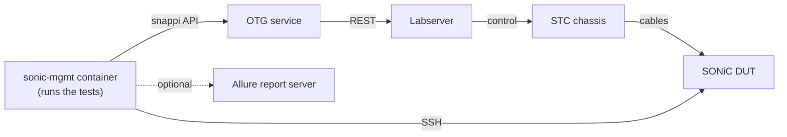

# run_snappi_test.sh — User Guide

`run_snappi_test.sh` sets up a Snappi / OTG / STC SONiC lab and runs the **pretest** and
**smoke test** with one command. Everything is controlled by a single file,
[`config.yaml`](config.yaml).

It automates the steps of the [Snappi Environment Setup and Quick Test Guide](../README.md):
deploy the environment, configure the testbed, push the minigraph, run the tests.

> **ℹ️ Intended use.** Quick pre-test and smoke test of a **1 traffic generator + 1 DUT**
> setup on **community (upstream) SONiC**. Enterprise SONiC and vendor forks are not
> validated. Only the testbed this tool generates from `config.yaml` is supported.

> **⚠️ Physical DUT warning.** With `deployment.target: physical` the tool can change your DUT:
> 1. **Minigraph push (`--deploy-mg`) replaces the switch's running configuration.** It runs
>    only when you ask for it (`--deploy-mg`, or `testbed.deploy_minigraph: true`). Use a
>    dedicated lab DUT and back up its config first.
> 2. **SSH key:** `--access-check` and every test run add the sonic-mgmt public key to the
>    DUT's `~/.ssh/authorized_keys` if it is missing. Nothing else on the DUT is changed.
>
> `--deploy-only` never touches a physical DUT.

## Contents

1. [What it deploys](#1-what-it-deploys)
2. [Prerequisites](#2-prerequisites)
3. [Quick start: virtual lab](#3-quick-start-virtual-lab)
4. [Using your own DUT and STC chassis](#4-using-your-own-dut-and-stc-chassis)
5. [Command-line usage](#5-command-line-usage)
6. [Configuration](#6-configuration)
7. [Re-running and cleaning up](#7-re-running-and-cleaning-up)
8. [Logs and results](#8-logs-and-results)
9. [Troubleshooting](#9-troubleshooting)
10. [Command cheat-sheet](#10-command-cheat-sheet)

---

## 1. What it deploys



| Component | What it does | Deployed by the tool |
|---|---|---|
| **sonic-mgmt container** | Runs the pretest and smoke test | Always |
| **Labserver** and **OTG service** | Connect the tests to the STC chassis | Yes, by default (or point to ones that already exist) |
| **STC chassis** and **SONiC DUT** | Traffic generator and device under test | **Virtual** target: yes, as containers. **Physical** target: you provide the hardware |
| **Allure server** | HTML test reports | Only if enabled |

Everything can run on one Linux host (including WSL2).

---

## 2. Prerequisites

**Host.** Ubuntu or another Debian-based Linux, or WSL2, with `sudo` access and internet
access to GitHub and your package mirrors. (The tool installs software with `apt`; Ubuntu
24.04 is tested.)

**Software.** Nothing needs to be installed up front. On the first run the tool installs
what is missing: git, curl, jq, make, unzip, sshpass, Docker, Docker Compose, containerlab
(virtual target only) and PyYAML. Use `--skip-env-check` to skip this, in which case Docker
must already be installed.

**Docker without `sudo` (recommended).** Add your user to the `docker` group before the
first run, then log out and back in (or run `newgrp docker`, or `wsl --shutdown` on WSL):

```bash
sudo usermod -aG docker $USER
```

If the group is not active yet, the tool falls back to `sudo docker` for that run and may
ask for your sudo password.

**VIAVI software.** Get these from VIAVI support and put them in `images/` (next to
`config.yaml`):

| What | File name | Needed |
|---|---|---|
| STC chassis image | `stc_<version>.tgz` (or `Spirent_TestCenter_Docker_<version>.zip`) | Virtual target only |
| Labserver image | `labserver-<version>.tar.xz` | When the tool deploys the Labserver |
| OTG service installer | `otgservice.<major.minor>.*.sh` | When the tool deploys the OTG service |

You set **one** version, `deployment.stc.version`. The Labserver image must match it exactly;
the OTG installer only needs the same `major.minor` (for `5.62.0766`: `otgservice.5.62.*.sh`).
Run `./run_snappi_test.sh --list-versions` to see which versions are ready.

**License server.** Set `deployment.stc.license_server` (`@hostname`, `@10.10.10.10` or
`host:7443`) so the Labserver and virtual chassis can get a license. Contact
[VIAVI support](https://www.viavisolutions.com/support) if you don't have one. A missing
value only produces a warning; it never stops a run. If you license the lab another way, set
`deployment.stc.license_managed_externally: true` to silence the warning. If the Labserver
was deployed without a license, set the value and run `--deploy-only` again.

**Virtual DUT image.** Nothing to do by default: the `sonic-vs` image is downloaded and built
automatically on the first run. To use your own image, load it into Docker and set
`deployment.dut_vs.image` to its `repository:tag`.

---

## 3. Quick start: virtual lab

The shipped `config.yaml` is already a virtual lab. Run from the `container/` directory:

```bash
cd container

# 1. Copy the VIAVI files (section 2) into ./images/
# 2. Edit config.yaml and set at least:
#      deployment.stc.version         the STC version of your files
#      deployment.stc.license_server  your license server

./run_snappi_test.sh --validate        # 3. check config.yaml (deploys nothing)
./run_snappi_test.sh --list-versions   # 4. is your STC version ready?
./run_snappi_test.sh                   # 5. deploy and test
```

A full run ends with a summary and `RESULT: PASS` or `RESULT: FAIL`
([section 8](#8-logs-and-results)).

Handy extras:

- `-c my-lab.yaml` uses a config file from another location.
- `--show-config` prints what the run would use (versions, addresses, cleanup policy) without
  running anything.
- A misspelled key is reported as `unknown key ... (did you mean ...?)` and ignored. Read the
  warnings of your first run.

To deploy the environment but not run tests, use `./run_snappi_test.sh --deploy-only`.

---

## 4. Using your own DUT and STC chassis

Use this when you have a real DUT and STC chassis. Start from the shipped `config.yaml`
and change the following.

**1. Deploy the environment.** Set the target and the STC version (it must match the
version installed on your chassis; the tool does not check this):

```yaml
deployment:
  target: physical
  stc:
    version: "5.62.0766"
    license_server: "@license-server.company.com"
```

```bash
./run_snappi_test.sh --deploy-only     # never touches the DUT or chassis
```

**2. Add your equipment to the `testbed:` section and check access:**

```yaml
testbed:
  endpoints:
    stc_chassis_ip: "10.0.0.20"
  dut:
    hostname: "dut1"
    mgmt_ip: "10.0.0.30"
    hwsku: "Force10-S6000"
    credentials: { user: admin, password: admin }
```

```bash
./run_snappi_test.sh --access-check    # chassis and DUT reachable, DUT login works
```

**3. Describe the cabling and run the tests.** Set `testbed.dut.iface_speed`, `total_ports`
and `links` (at least 2 DUT-to-STC links) to match your hardware, then:

```bash
./run_snappi_test.sh --smoke-test      # or --pretest
```

`./run_snappi_test.sh --validate` lists any `testbed:` keys that are still missing.

Things to know on a physical DUT:

- The DUT's configuration is **not** changed by default. Configure it yourself to match the
  testbed (VLAN `testbed.topology.vlan`, ports in `links`), or let the tool push a minigraph
  with `--deploy-mg` (dedicated lab DUT only).
- Physical runs are supported but **not validated**. Results depend on your DUT
  configuration, cabling and VLAN setup.
- The Labserver on this host must be able to reach the chassis.

**If a Labserver and/or OTG service already exists** (for example a shared lab Labserver),
tell the tool not to deploy it and give its address:

```yaml
deployment:
  otg_labserver:
    docker_compose: { enabled: false }
    labserver:   { mode: provisioned }     # already exists
    otg_service: { mode: provisioned }     # already exists
testbed:
  endpoints:
    labserver_ip: "10.0.0.21"
    otg_service: { ip: "10.0.0.22", port: 50051 }
```

The tool never deploys, changes or removes a `provisioned` component. You can mix the two:
with `otg_service: { mode: standalone }` the tool deploys its own OTG service against the
existing Labserver (omit `otg_service` under `testbed.endpoints`, but `labserver_ip` must be
set before `--deploy-only`).

---

## 5. Command-line usage

```
./run_snappi_test.sh [-c config.yaml] [option]
```

**Run everything**

| Command | What it does |
|---|---|
| *(no option)* | Full run: deploy, check access, generate testbed config, push minigraph (virtual lab), pretest, smoke test, report |

**Run step by step** (in this order)

| Command | What it does |
|---|---|
| `--deploy-only` | Deploy the environment and stop. Reads only `deployment:` |
| `--access-check` | Check that the chassis, DUT, and any existing Labserver / OTG service are reachable and the DUT login works |
| `--gen-config` | Regenerate the sonic-mgmt testbed files after you change `config.yaml` |
| `--deploy-mg` | Push the minigraph to the DUT (always pushes; replaces a physical DUT's configuration) |
| `--pretest` | Run only the pretest |
| `--smoke-test` | Run only the smoke test |
| `--test-only` | Run pretest and smoke test against the environment that is already deployed |

Every step from `--access-check` on needs a deployed environment, so run the full command or
`--deploy-only` first. Every test step also runs the access check and config generation first.

**Deployment check.** `--deploy-only` (and the deploy part of a full run) records what it
deployed: `deployment.target`, `deployment.stc.version`, the deployment host address, and the
Labserver and OTG service mode. `--pretest`, `--smoke-test`, `--test-only` and the test stage of
a full run compare these with the current `config.yaml` and stop before running anything if they
differ, listing each changed value. Run `--deploy-only` again to deploy the new configuration.
If nothing has been deployed yet (or the last deploy did not finish) they stop with a message to
run `--deploy-only`. Other settings, such as `testbed:` and the license server, are not part of
this check.

**Inspect and maintain**

| Command | What it does |
|---|---|
| `--validate` | Check the whole `config.yaml` and exit. Deploys nothing |
| `--show-config` | Print the settings a run would use and exit |
| `--list-versions` | Show which STC versions are ready to deploy |
| `--destroy` | Remove what this tool created ([section 7](#7-re-running-and-cleaning-up)) |
| `--no-cleanup` | Keep the pytest / Ansible cache after the tests (for debugging) |
| `--skip-env-check` | Skip the host software check and install |
| `-h`, `--help` | Show the built-in help |

**Minigraph.** On a virtual lab it is pushed automatically before the tests (`--pretest` and
`--smoke-test` skip it if it was already pushed since the last deploy). On a physical DUT it
is never pushed automatically, unless you set `testbed.deploy_minigraph: true` or run
`--deploy-mg`.

The tool remembers a successful push, and forgets it when it can no longer apply:

- A virtual DUT is recreated by every deploy, so `--deploy-only` (or a full run) forgets the push.
  A push that fails or is interrupted is not remembered either.
- `--gen-config` (and every test step, which runs it first) forgets the push when the settings the
  minigraph is built from have changed since it: `testbed.dut` (`hostname`, `mgmt_ip`, `hwsku`,
  `iface_speed`, `total_ports`, `links`), `testbed.topology`, and whether
  `testbed.deploy_minigraph` resolves to a push. Other settings do not matter. On a virtual lab
  the next test step pushes again by itself; otherwise it prints "Testbed configuration changed"
  and you run `--deploy-mg`.
- On a physical DUT this is only the tool's own record. The DUT may have been changed by hand since,
  so it is never treated as proof of the DUT's configuration, and `auto` still never pushes to it.

---

## 6. Configuration

`config.yaml` has two sections. Every key is explained in comments inside the file.

| Section | Contains | Same steps done by hand |
|---|---|---|
| `deployment:` | What the tool deploys: STC version, images, Labserver / OTG service, DUT image, sonic-mgmt source, Allure, cleanup, logging | [Guide §3](../README.md#3-deploy-the-test-environment) |
| `testbed:` | How the lab looks to the tests: addresses of existing equipment, DUT login, cabling, VLAN. Not needed for `--deploy-only` | [Guide §4](../README.md#4-configure-the-snappi-testbed) |

**Keys you will usually change**

| Key | Meaning |
|---|---|
| `deployment.target` | `virtual` (default): chassis and DUT run as containers. `physical`: your own hardware |
| `deployment.stc.version` | STC version; picks the chassis, Labserver and OTG files in `images/` |
| `deployment.stc.license_server` | License server for the Labserver and virtual chassis |
| `deployment.images.dir` | Folder holding the VIAVI files (default `./images`) |
| `deployment.otg_labserver.docker_compose.enabled` | `true` (default): deploy Labserver and OTG service together. `false`: choose `standalone` or `provisioned` for each |
| `deployment.otg_labserver.host_ip` | This host's address. Leave empty unless auto-detection picks the wrong network interface |
| `deployment.dut_vs.image` | Virtual DUT image (default `vrnetlab/sonic_sonic-vs:master`) |
| `deployment.sonic_mgmt.source_dir` | Empty: the tool clones sonic-mgmt. Set it to reuse your own checkout |
| `deployment.allure.enabled` | `true` also deploys the Allure report server (default `false`) |
| `deployment.cleanup.env_on_failure` | `true`: remove the environment when a test fails (default `false`) |
| `testbed.endpoints`, `testbed.dut` | Addresses, login and cabling of equipment you provide |
| `testbed.deploy_minigraph` | `auto` (default), `true` or `false` |

Leave `testbed.definition` and `testbed.topology` at their defaults; other values are untested.

**Where an address goes.** Put it where it is owned: if the tool deploys the component, the
address is in `deployment:`; if you provide it, the address is in `testbed:`. Setting the same
address to different values in both is an error.

| Component | Deployed by the tool | Already exists |
|---|---|---|
| Labserver, OTG service | `deployment.otg_labserver.host_ip` (auto) | `testbed.endpoints.labserver_ip`, `testbed.endpoints.otg_service` |
| STC chassis | `deployment.stc.mgmt_ip` (virtual) | `testbed.endpoints.stc_chassis_ip` (physical) |
| DUT | `deployment.dut_vs.*` (virtual) | `testbed.dut.*` (physical) |

**What each command reads.** A command checks only the part of `config.yaml` it uses, so a
file can pass `--deploy-only` and still fail a later step. `--validate` checks everything up
front.

| Command | Needs from `config.yaml` |
|---|---|
| `--deploy-only`, `--destroy`, `--list-versions` | `deployment:` only (plus `testbed.endpoints.labserver_ip` if you deploy your own OTG service against an existing Labserver) |
| `--access-check` | The above, plus `testbed.endpoints` and, for a physical DUT, `testbed.dut.mgmt_ip` and `credentials` |
| `--gen-config`, `--deploy-mg`, `--pretest`, `--smoke-test`, `--test-only`, full run, `--validate` | All of `testbed:` |

`--show-config` checks the same as a full run but reports `testbed:` problems as warnings.

**sonic-mgmt source, patch and custom tests.** The tests run from a sonic-mgmt checkout:

- `deployment.sonic_mgmt.source_dir` empty: the tool clones sonic-mgmt (`repo`, `branch`) and
  keeps it on `baseline_commit`, the commit the patch is validated against. If that clone has
  uncommitted changes *and* is on another commit, the run stops instead of discarding them.
- `source_dir` set to your own checkout: the tool never checks out or resets it. The patch and
  custom tests are applied only if the checkout has no uncommitted changes.
- `patch.apply: true` applies the STC/OTG compatibility patch once (an already patched
  checkout is skipped).
- `custom_tests.overwrite: true` copies VIAVI's customized snappi tests
  (`custom_tests.source_dir`, default `../example/sonic_snappi/tests`) over the checkout on
  every full run and every `--deploy-only`. This includes the root `tests/conftest.py`, so it
  also affects non-snappi suites run from the same checkout.

Relative paths in `config.yaml` are relative to the config file. The shipped passwords
(`admin` / `admin`) are lab defaults; change them for a real DUT.

---

## 7. Re-running and cleaning up

**Re-running is safe.** Healthy parts are reused: installed software, the sonic-mgmt
container and source, and the Labserver / OTG service. The virtual chassis and DUT are
redeployed on every run. Your custom tests are re-copied each time.

**Changing the STC version.** By default (`replace_on_version_change: true`) the tool
removes the environment it created and redeploys it on the new version. An existing Labserver
is reused even if its version differs (the tool only warns). To force the new version, run
`docker rm -f labserver` and deploy again.

**When a test fails.** The run exits with an error and leaves the environment as it is, so you
can investigate. Set `deployment.cleanup.env_on_failure: true` to remove it automatically.

**Removing the environment.**

```bash
./run_snappi_test.sh --destroy
```

This removes only what the tool created: the sonic-mgmt, Labserver, OTG, Allure and
containerlab containers. It never touches Labserver / OTG services you marked `provisioned`,
your own sonic-mgmt checkout, or a physical DUT and chassis. By default it also keeps the
built `sonic-vs` and OTG images, the downloaded `vrnetlab` files and the cloned sonic-mgmt
source, so the next deploy is faster (see the `keep_*` keys in `config.yaml`). Your own files
in `images/` are never removed.

The hidden `.run_snappi_test/` folder is the tool's working area. Use `--destroy` instead of
deleting it by hand.

---

## 8. Logs and results

Each run writes to `logs/<date_time>/`, inside the folder you run the script from (change it
with `deployment.logging.dir`):

| File | Contents |
|---|---|
| `run.log` | Everything the run did, step by step |
| `deploy_services.log`, `env_check.log` | Details of the deployment and software setup |
| `deploy_mg.log`, `pretest.log`, `smoke_test.log` | Full output of each test step |
| `summary.json` | Overall result and the status of each step |

The console shows a `SNAPPI TEST CONFIGURATION` block at the start and a `SNAPPI TEST SUMMARY`
at the end with `RESULT: PASS` or `RESULT: FAIL`. If Allure is enabled, the report URL is shown
there too.

---

## 9. Troubleshooting

When something fails, the message names the `config.yaml` key to check. `--validate` and
`--show-config` are safe to run at any time.

| Problem | What to do |
|---|---|
| `Another run_snappi_test.sh run is already holding the lock` | Wait for the other run. If none is running, delete `.run_snappi_test/run.lock` |
| `config.yaml failed validation` / `missing required key` | Add the key it names. `--validate` checks everything at once |
| `testbed.<key> conflicts with deployment.<key>` | The same address is set differently in both sections. Keep it only where it is owned ([section 6](#6-configuration)) |
| `Ambiguous artifact match` | Several files match your version. Remove the stale one |
| A required file is missing | Check the file names in [section 2](#2-prerequisites) and `./run_snappi_test.sh --list-versions` |
| `... not reachable` (DUT, chassis, Labserver, OTG) | The address is wrong or unreachable from this host. Check the key in the message |
| `Failed to install SSH key on DUT` | Wrong DUT login. Check the credentials in `testbed.dut` (physical) or `deployment.dut_vs` (virtual) |
| `permission denied ... docker.sock` | Your `docker` group membership is not active yet. Log out and back in, or accept the `sudo` fallback |
| `A container named 'labserver'/'otg' already exists` | A container from elsewhere is in the way. The tool never removes it. Remove it yourself, or mark it `provisioned` and add its address to `testbed.endpoints` |
| `host port ... is already in use` | Another process uses the port. Run `--destroy`, free the port, re-run |
| Labserver cannot connect to the chassis or reserve ports | Check that `deployment.stc.version` equals the chassis version, that the Labserver can reach the chassis, and that it is licensed |
| `This test requires at least 2 ports`, or the test hangs on ARP | Check that `testbed.dut.links` has 2 or more entries and the VLAN matches the DUT. Push the minigraph again (`--deploy-mg`) after changing topology |
| `DUT ... SSH port not reachable after redeploy` | A newly published `sonic-vs` image can be bad. Load a known-good image and set it in `deployment.dut_vs.image` |
| `Configuration has changed since the environment was deployed` | You changed a deployment setting after `--deploy-only`. Run `--deploy-only` again, or restore the old value |
| `No deployment record found` | Nothing has been deployed yet, the last deploy did not finish, or the environment was deployed by an older version of this tool or removed with `--destroy`. Run `--deploy-only` |
| Stale results or ignored config changes | Run again without `--no-cleanup`. If that does not help, `--destroy` and re-run |
| Deploy takes minutes | Normal for image pulls and builds. Follow `deploy_services.log` |

If you are stuck, run `--destroy` and start again. That never affects a physical DUT or
`provisioned` services.

---

## 10. Command cheat-sheet

```bash
# Run everything
./run_snappi_test.sh                   # full run: deploy, access check, testbed config, minigraph (virtual lab), pretest, smoke test, report
./run_snappi_test.sh -c my-lab.yaml    # use a config file from another location

# Check before you run (deploys nothing)
./run_snappi_test.sh --validate        # check the whole config.yaml
./run_snappi_test.sh --show-config     # print the settings a run would use
./run_snappi_test.sh --list-versions   # which STC versions are ready to deploy

# Run step by step
./run_snappi_test.sh --deploy-only     # deploy the environment and stop
./run_snappi_test.sh --access-check    # equipment reachable, DUT login works (physical DUT: installs the sonic-mgmt key)
./run_snappi_test.sh --gen-config      # regenerate the testbed files after editing config.yaml
./run_snappi_test.sh --deploy-mg       # push the minigraph (replaces a physical DUT's configuration)
./run_snappi_test.sh --pretest         # pretest only
./run_snappi_test.sh --smoke-test      # smoke test only
./run_snappi_test.sh --test-only       # pretest and smoke test on the environment that is already deployed

# Options and clean-up
./run_snappi_test.sh --no-cleanup      # keep the pytest / Ansible cache for debugging
./run_snappi_test.sh --skip-env-check  # skip the host software check and install
./run_snappi_test.sh --destroy         # remove everything this tool created
./run_snappi_test.sh --help            # built-in help
```
